# ESPN FootyTips — Competitions UX & Scope Analysis

> Source: https://footytips.espn.com.au/competitions · Captured: 18 Nov 2026
> Viewports: desktop 1440×900 + mobile 390×844 (emulated, 2× DPR) · Screens: 14
> Screenshots: 0 reused · 25 captured
> Evidence: [O] observed · [I] inferred · [?] unknown

Scope of this document: the **Competitions** area only — the competitions list,
the create-competition wizard, competition discovery, and a single competition's
management shell (Ladder, Members, Invites, Wall, Settings). Tipping screens are
covered by the separate `espn-footytips-aleague-tipping-ux-spec.md` audit.

**Privacy note:** the competition screenshots show a real private competition.
They contain real members' display names, a competition password, an invite URL
and a personal welcome message. Treat the `screens/` folder as internal — do not
paste it into tickets or public issues without redaction.

## 1. Product summary

ESPN FootyTips is a free, season-long tipping competition product for Australian
football codes. A player joins competitions ("comps") — a global site-wide
ladder every player is on automatically, plus private comps their mates create —
then tips winners each round and compares ladders. The Competitions area is the
social and administrative half of that loop: it is where a player sees how they
are tracking across every comp at once, and where a comp administrator controls
membership, naming, game modes and scoring.

The product is structurally comp-centric rather than tipping-centric. A player
tipping in AFL sees one comp card per competition, each carrying only that
comp's round score, round rank, comp rank and total score — the tips themselves
live one level away, behind a shared "View Tips" button. Competition creation is
a four-step wizard that is deliberately more ambitious than tipping: it offers
nine sports (AFL, AFL Women's, NBA, NBL, T20 Big Bash League, A-League Men,
Champions League, Football World Cup, Premier League, NFL, Super Netball, NRL,
NRL Women's, Super Rugby) and three game modes (Tipping, Flexi, Streak).

Visible business-model signals are advertising and app-install promotion, not
subscription: the layout reserves a right-hand rail for an AFL ladder widget,
and the competitions list's DOM carries display-ad click-through links
(`pubads.g.doubleclick.net/...iu=/21783347309/espn.footytips.nondart`) whose
anchor text is a set of prize-dollar values ($5.00–$251.00). Those ad slots were
not visibly rendered in the captured viewport, so treat them as inventory rather
than as rendered layout.
The footer is Disney corporate boilerplate — "2026 The Walt Disney Company
(Australia) Pty Ltd" — plus App Store and Google Play badges for the mobile app.
There is no pricing, trial or upgrade surface anywhere in the area.

Maturity reads as long-lived and feature-complete but visually dated in places:
every URL is server-rendered with query-string state (`?ff=members`,
`?ff=settings`), the same "2026 AFL Ladder" widget is repeated on every screen,
copy contains a typo in the primary admin CTA ("Create Comptition"), and the
mobile web layout is a collapsed version of the desktop one rather than a
purpose-built mobile experience — even though the product is presented as an app
first.

## 2. Screen inventory

| # | Screen | Route | Purpose | Viewports | Screenshot |
|---|---|---|---|---|---|
| 01 | Competitions landing | `/competitions` | All comps the player is in, with per-comp scores and a create/search entry point | desktop, mobile | [desktop](screens/01-competitions-landing-desktop.png) · [mobile](screens/01-competitions-landing-mobile.png) |
| 02 | Create comp — step 1 "Name & Access" | `/competitions?ff=createcomp` | Name the comp, set URL slug, picture, public/private, fees, prizes, welcome message | desktop, mobile | [desktop](screens/02-create-competition-step1-desktop.png) · [mobile](screens/02-create-competition-step1-mobile.png) |
| 03 | Create comp — step 1 validation | same | Inline error state after advancing with empty required fields | desktop | [desktop](screens/03-create-competition-step1-validation-desktop.png) |
| 04 | Create comp — step 2 "Pick Your Sports" | same | Multi-select sports the comp will cover | desktop, mobile | [desktop](screens/04-create-competition-step2-sports-desktop.png) · [mobile](screens/04-create-competition-step2-sports-mobile.png) |
| 05 | Create comp — step 3 "Pick Your Games" | same | Choose game modes: Tipping, Flexi, Streak | desktop, mobile | [desktop](screens/05-create-competition-step3-games-desktop.png) · [mobile](screens/05-create-competition-step3-games-mobile.png) |
| 06 | Create comp — step 4 "Custom Scoring" | same | Opt in/out of custom scoring, then submit | desktop, mobile | [desktop](screens/06-create-competition-step4-scoring-desktop.png) · [mobile](screens/06-create-competition-step4-scoring-mobile.png) |
| 07 | Find a comp to join | `/competitions?ff=searchcomp` | Search/filter public comps, or divert to create your own | desktop, mobile | [desktop](screens/07-search-competitions-desktop.png) · [mobile](screens/07-search-competitions-mobile.png) |
| 08 | Competition — Ladder | `/competitions/afl/ladder?competitionId=384349&userloc=10&ladderId=10211584` | Ranked table of members by round scores; the comp's home tab | desktop, mobile | [desktop](screens/08-comp-ladder-desktop.png) · [mobile](screens/08-comp-ladder-mobile.png) |
| 09 | Competition — Members | `…&ff=members` | Roster of everyone in the comp | desktop, mobile | [desktop](screens/09-comp-members-desktop.png) · [mobile](screens/09-comp-members-mobile.png) |
| 10 | Competition — Invites | `…&ff=invites` | Invite by email or from existing friends | desktop, mobile | [desktop](screens/10-comp-invites-desktop.png) · [mobile](screens/10-comp-invites-mobile.png) |
| 11 | Competition — Wall | `…&ff=wall` | Comp-scoped message board | desktop, mobile | [desktop](screens/11-comp-wall-desktop.png) · [mobile](screens/11-comp-wall-mobile.png) |
| 12 | Competition — Settings | `…&ff=settings` | Name/access, admin rights, sports, ladders & scoring, picture | desktop, mobile | [desktop](screens/12-comp-settings-desktop.png) · [mobile](screens/12-comp-settings-mobile.png) |
| 13 | My preferences (comp-scoped dialog) | `…&ff=settings` + "My Preferences" | Member-level consent: admin tip editing, email visibility | desktop | [desktop](screens/13-comp-my-preferences-modal-desktop.png) |
| 14 | Site ladder | `/competitions/afl/siteladder?userloc=772697` | The global comp every player is in, by definition | desktop | [desktop](screens/14-site-ladder-desktop.png) |

## 3. Core functionality map

### Competitions overview
- **See every comp you belong to in one list** [O] — landing, `AFL - Grand Final Results` band containing one card per comp plus the global site ladder card.
- **Per-comp score summary without opening the comp** [O] — four KPI tiles per card: `Round Score`, `Round Rank`, `Comp Rank`, `Total Score`.
- **Jump straight to tipping** [O] — red `View Tips` button per sport band, linking to `/tipping/afl`.
- **Reorder / collapse sports** [O] — `Re-Order Sports` link next to `Current Sports: 1`; `Show More` button below the card stack (presence implies more comps can exist than are shown) [I].
- **Search across comps** [O] — `Search Competitions…` field on desktop, `Search Competition` button on mobile.
- **Invite from the list** [O] — `INVITE` affordance on each private comp card, including the comp this account is only a *member* of, so inviting is not admin-gated there [I].

### Competition creation
- **Four-step wizard with persistent progress stepper** [O] — `Name & Access → Pick Your Sports → Pick Your Games → Custom Scoring`, no step counter text, no save-and-resume.
- **Name + custom URL slug** [O] — `Competition Name` and `Customise URL` with fixed prefix `https://footytips.espn.com.au/comps/`.
- **Comp picture upload** [O] — drag-and-drop zone + `Choose Image`, accepts GIF/JPEG/JPG/PNG, "Optimal size is 100 x 100 pixels", "Images may not appear immediately and are subject to approval" → moderation queue exists [I].
- **Visibility: Public / Private** [O] — segmented control; the reviewed comp's settings show `Private (password: McCluskey)`, so private comps are password-gated [O] (settings screen) / password is set somewhere not captured [?].
- **Entry fee and prizes declaration** [O] — `Is there an entry fee?` and `Does your competition have prizes?`, both No/Yes, both rendered `NA` in settings when No [O].
- **Welcome message** [O] — free-text textarea, surfaced verbatim in Settings.
- **Multi-sport comps** [O] — 14 sports across 9 sport groups, `Select All` / `Clear Selection`; legend marks favourite sport and sports you already tip.
- **Game modes per comp** [O] — Tipping, Flexi (flexi-points × betting odds), Streak.
- **Custom scoring opt-in** [O] — final step is a single Yes/No; the actual scoring editor was not reachable without submitting [?].

### Competition management
- **Round-by-round ladder** [O] — one column per round `OR - R9`, `R10`…`R24`, `WC`, `FW1`, `SF`, `PF`, `GRAND FINAL`, plus `TOTAL SCORE`; every column header is a sort control.
- **Filter the ladder** [O] — `Round`, `Ladder`, `Year` dropdowns (`roundValue`, `ladderValue`, `seasonValue`).
- **Find a tipper** [O] — `Search by tippers name`.
- **Export the ladder** [O] — `Export` button next to the table (format not confirmed [?]).
- **KPI rail on the ladder tab** [O] — `2026 Top Finishers`, `Your Placing`, `Round Average`.
- **Member roster with search** [O] — `Member List`, 25 rows, `Search by members name`.
- **Invite by email or by friend picker** [O] — `Add Recipients`, email field, `Search by member name` with per-friend checkboxes and a `checkAll`, optional message, `Send Invite`.
- **Comp wall** [O] — `Leave a comment…` composer with `Post` / `Cancel`.
- **Comp settings, editable in place** [O] — sections `Name & Access`, `Admin Rights`, `Sports & Games`, `Ladders & Scoring`, `Comp Picture`. For the reviewed comp the fields render as read-only text because the viewer is not the administrator [O] / rendered as inputs for the admin [I].
- **Transfer/hold admin** [O] — `Admin Rights` documents a single `Administrator`; no add/remove control visible to a member [?].
- **Per-member preferences** [O] — `My Preferences` dialog: allow the admin to enter/edit your tips, and whether to display your email to the admin.
- **Leave a comp** [O] — `Leave Comp` button with a `Leave` confirmation control in the DOM.
- **Change comp without going back to the list** [O] — `Change Competition` control in the comp header.

### Not evidenced in this area
- Editing or deleting a comp; archiving or renewing a comp for a new season; member removal/kick; admin transfer; comp-level join requests/approval; commenting, reactions or likes on the wall; notifications for wall posts; prize distribution; any paid-comp checkout; any comp analytics beyond the four KPIs.

## 4. Screen-by-screen analysis

### 01 — Competitions landing

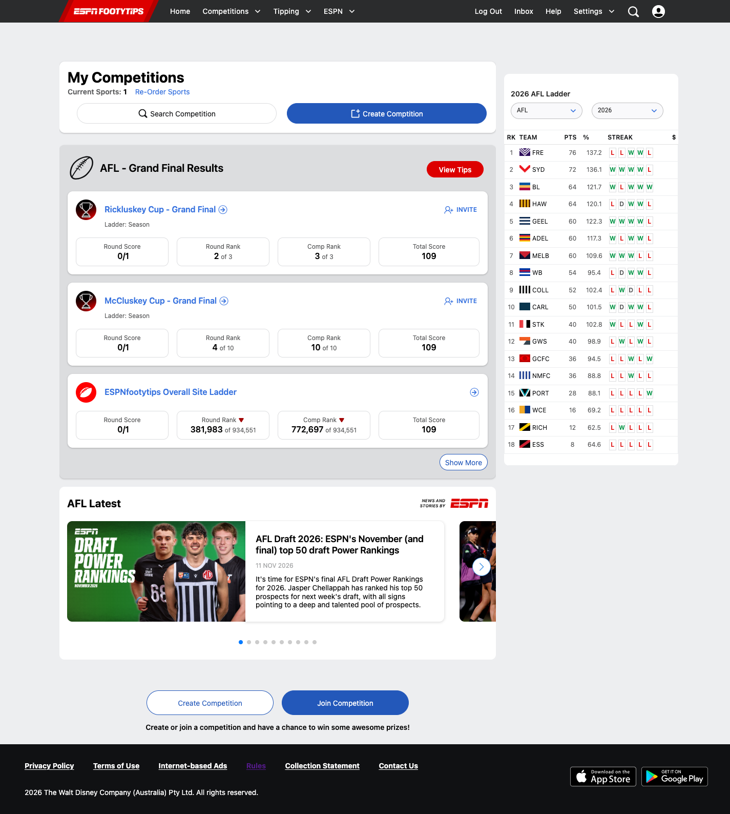

- **Purpose.** The player's home for every comp they belong to, with enough score context to decide what to do next.
- **Primary goal.** See where you stand and get back into tipping.
- **Layout & components.** Two-column page: 815px main card, 330px rail. Main card top band = `My Competitions` (h1) with `Current Sports: 1` and a `Re-Order Sports` text link, a search field (`Search Competitions…`) and a filled blue `Create Competition` button. Below, a grey sport band `AFL - Grand Final Results` with a ball glyph and a red `View Tips` pill on the right. Then three comp cards, a `Show More` pill, an `AFL Latest` news carousel (`NEWS AND STORIES BY ESPN`, 9 pagination dots), and a closing CTA pair: outlined `Create Competition`, filled `Join Competition`, with the line "Create or join a competition and have a chance to win some awesome prizes!".
- **Comp card anatomy.** Trophy crest, comp name as a blue link with an "external/enter" arrow, a `INVITE` affordance with a two-person glyph at the right, the sub-label `Ladder: Season`, then a 4-tile KPI strip: `Round Score 0/1`, `Round Rank 4 of 10`, `Comp Rank 10 of 10`, `Total Score 109`. The site-ladder card substitutes a red ESPN ball crest, drops `Ladder: Season` and `INVITE`, and shows population-scale ranks (`381,983 of 934,551`) with red down-triangles beside them.
- **Data shown.** Three comps: two private (`of 3`, `of 10` members) and one site-wide (`of 934,551`). All three report `Round Score 0/1` and `Total Score 109` — the same master card feeding three comps [O].
- **Actions & controls.** Search, create, reorder sports, view tips, enter comp, invite, show more, carousel pagination.
- **States.** No lockout/open indicator anywhere on the card; `0/1` is the only progress signal. Site-ladder rank deltas use colour + triangle only. No empty state was reachable (the account is in three comps) [?].
- **Responsive.** Mobile drops the rail, collapses the nav to a hamburger, and turns the search field into a `Search Competition` button; KPI tiles wrap 3-up with `Total Score` on its own full-width row; `INVITE` disappears from the card; the CTA pair stacks full-width and the footer becomes a two-column link grid.
- **UX observations.** The card answers "where am I" well and "what next" badly: `View Tips` is a whole-band button detached from the comps it serves. `Comp Rank 10 of 10` and `Round Rank 4 of 10` sit adjacent with near-identical labels and different meanings — one is the season, one is the round [I]. Invite affordances competing with the comp's own name dilute the click target.
- **Evidence vs inference.** All values observed. All click destinations inferred.

### 02 — Create comp, step 1 "Name & Access"

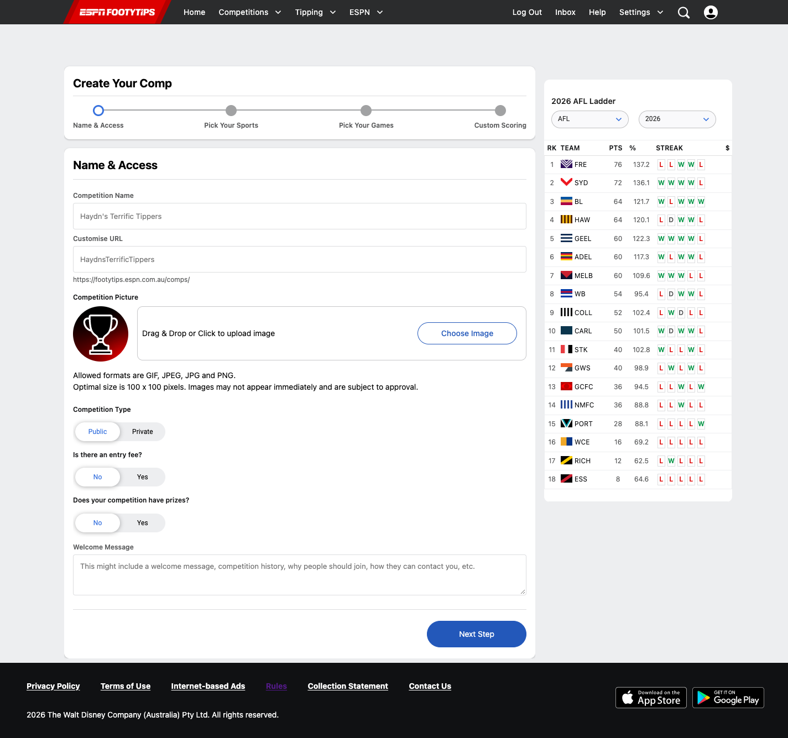

- **Purpose.** Collect identity and policy for a new comp.
- **Layout & components.** Same two-column shell, but the main card is now the wizard: `Create Your Comp` header, a 4-node horizontal stepper (`Name & Access`, `Pick Your Sports`, `Pick Your Games`, `Custom Scoring`) with the current node as a hollow blue ring and future nodes grey dots; then a white form card `Name & Access` with underlined section rule; fields `Competition Name`, `Customise URL`, `Competition Picture`, `Competition Type`, `Is there an entry fee?`, `Does your competition have prizes?`, `Welcome Message`; a right-aligned `Next Step` pill at the card foot.
- **Inputs.** Text: name (placeholder `Haydn's Terrific Tippers`), slug (placeholder `HaydnsTerrificTippers`) with a static prefix `https://footytips.espn.com.au/comps/` below it. Upload: trophy placeholder image + drag-and-drop zone + `Choose Image`, with constraints "Allowed formats are GIF, JPEG, JPG and PNG." and "Optimal size is 100 x 100 pixels. Images may not appear immediately and are subject to approval." Segmented pairs: `Public | Private`, `No | Yes`, `No | Yes`. Textarea: welcome message with a long prompt placeholder.
- **Defaults.** `Public` selected; both fee and prizes default to `No`.
- **Actions & controls.** `Choose Image`, the three segmented pairs, `Next Step`. No `Cancel`, no `Save draft`, no stepper node is clickable.
- **States.** Empty form is fully submittable; validation only on advance (see 03). Stepper shows completion by a filled blue dot, not by a check.
- **Responsive.** Identical field order; the upload zone and its preview stack; segmented pairs stretch full width; `Next Step` becomes a full-width pill at the end of a ~3,100px page.
- **UX observations.** The URL slug is the only field whose purpose needs a paragraph, and it gets a bare prefix with no example of the resulting link. The stepper gives no sense of effort remaining (2 of 4 steps are single-question). `Next Step` is the only way forward and the only way to discover what is required.
- **Evidence vs inference.** Fields, constraints and defaults observed. That the slug must be unique, and that images enter a moderation queue, are inferred from the copy.

### 03 — Create comp, validation state

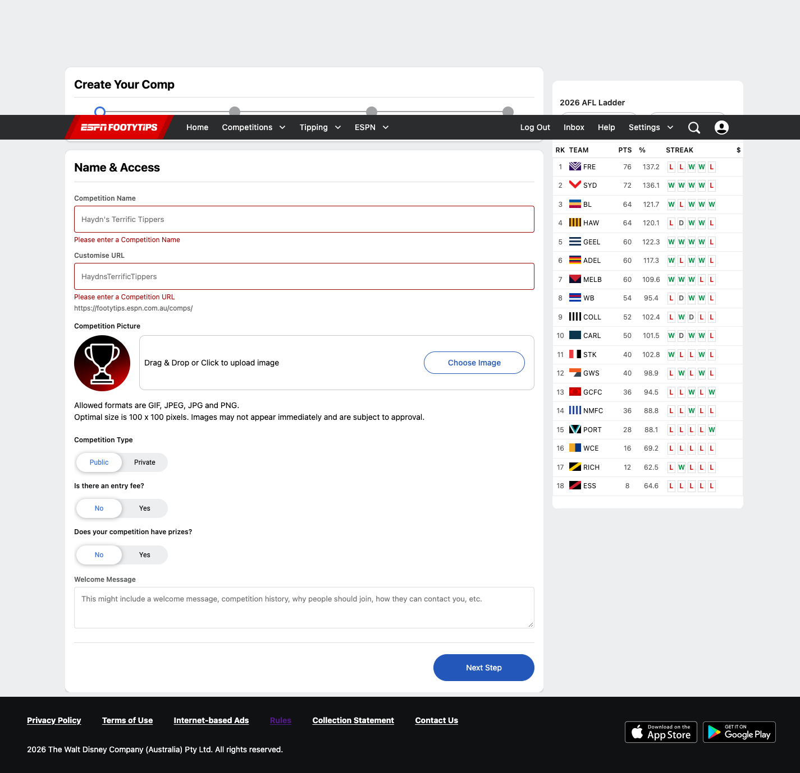

- **Purpose.** Error state of step 1.
- **What happens.** Clicking `Next Step` with both required text fields empty leaves the user on step 1, turns both field borders red and prints inline red messages directly beneath them: `Please enter a Competition Name`, `Please enter a Competition URL`.
- **Layout impact.** The two messages add ~20px each and push the rest of the form down; nothing scrolls into view, nothing is summarised, no `aria-live` region was observed [?].
- **States.** Field-level error only. No page-level banner, no error icon, no focus move observed. Non-required fields are not marked required beforehand.
- **UX observations.** Both errors fire at once, which is correct, but the user only learns the fields are required after trying to leave. `Customise URL` is labelled as optional-sounding customisation but is in fact required.
- **Capture artefact.** The global header appears a second time mid-page in this shot — a sticky-header capture artefact, not a UI defect.

### 04 — Create comp, step 2 "Pick Your Sports"

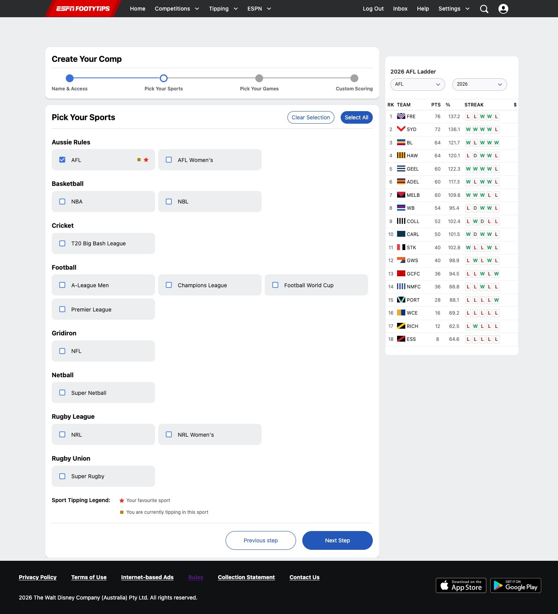

- **Purpose.** Choose which sports the comp will cover.
- **Layout & components.** Stepper node 2 active. Card `Pick Your Sports` with `Clear Selection` (outlined) and `Select All` (filled blue) at the top right; then sport groups as section headings (`Aussie Rules`, `Basketball`, `Cricket`, `Football`, `Gridiron`, `Netball`, `Rugby League`, `Rugby Union`) each holding a responsive grid of large checkbox tiles; then a `Sport Tipping Legend:` with a red star (`Your favourite sport`) and an olive square (`You are currently tipping in this sport`); footer `Previous step` + `Next Step`.
- **Options observed.** AFL, AFL Women's, NBA, NBL, T20 Big Bash League, A-League Men, Champions League, Football World Cup, Premier League, NFL, Super Netball, NRL, NRL Women's, Super Rugby — 14 competitions in 9 groups.
- **States.** Tiles are 2–3 per row on desktop, selected state is a blue tick; the player's own signals (star, square) render as small coloured markers at the tile's right edge.
- **Actions & controls.** Individual tiles, `Select All`, `Clear Selection`, step navigation. No per-sport settings here (rounds, scoring) — those are deferred.
- **Responsive.** Grid collapses to a single column; the two bulk-action buttons move under the card title; the legend stacks its two keys vertically.
- **UX observations.** This is the best-explained screen in the product: every constraint is visible, bulk actions are present, and the personal markers prevent duplicate comps by accident. The one gap is that selecting two sports gives no hint about whether the comp needs one ladder per sport or shares rounds.
- **Evidence vs inference.** Sports list observed. That multiple sports create multiple ladders is inferred from the Settings `Ladders & Scoring` table.

### 05 — Create comp, step 3 "Pick Your Games"

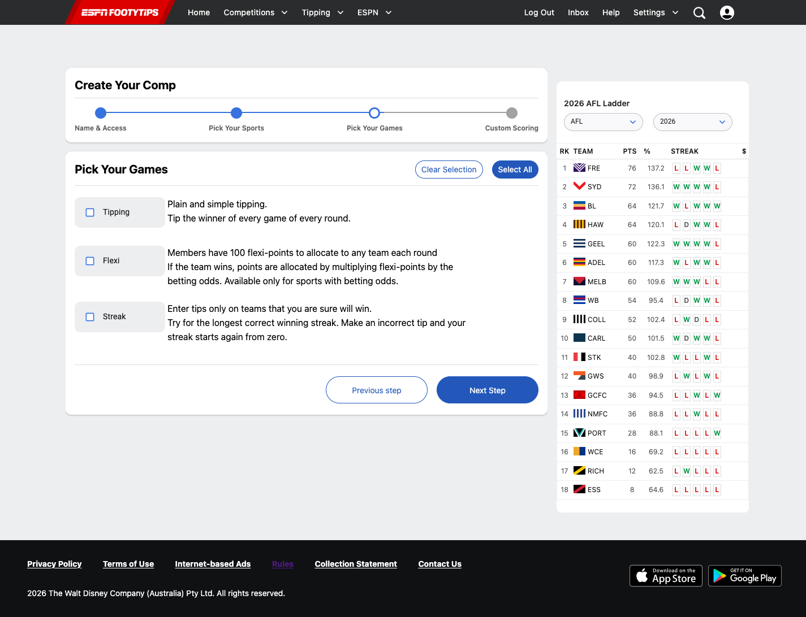

- **Purpose.** Choose the game mode(s) the comp will play.
- **Layout & components.** Card `Pick Your Games`, same bulk-action pair, then three wide rows. Each row = a bordered checkbox tile with the mode name on the left and a two-line description to its right: `Tipping` — "Plain and simple tipping." / "Tip the winner of every game of every round."; `Flexi` — "Members have 100 flexi-points to allocate to any team each round" / "If the team wins, points are allocated by multiplying flexi-points by the betting odds. Available only for sports with betting odds."; `Streak` — "Enter tips only on teams that you are sure will win." / "Try for the longest correct winning streak. Make an incorrect tip and your streak starts again from zero."
- **States.** Multi-select, zero preselected (validation copy `Please choose a sport` appears if you advance with none from step 2; an equivalent for games was not observed [?]).
- **Responsive.** The three rows stack with the description under the label — the longest description runs to four lines and pushes `Next Step` far down the page.
- **UX observations.** The `Flexi` copy is the only place in the product that mentions betting odds, and it does so in a creation flow aimed at casual players — a compliance and brand divergence worth noting for any non-betting clone. Otherwise the descriptions are models of the pattern: name, one-line promise, one-line mechanic.
- **Evidence vs inference.** Copy quoted exactly. Whether the three modes can be combined in one comp is [?] (the UI allows multiple ticks).

### 06 — Create comp, step 4 "Custom Scoring"

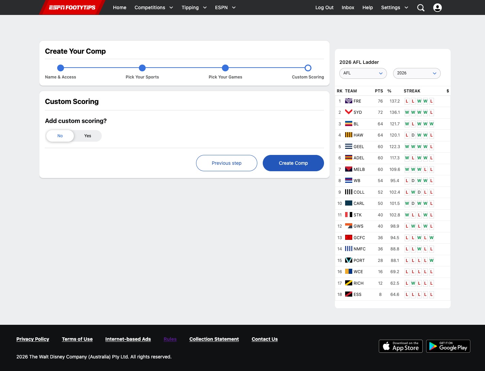

- **Purpose.** Final decision and submit.
- **Layout & components.** Stepper node 4 active. Card `Custom Scoring` containing one question, `Add custom scoring?`, with a `No | Yes` segmented pair, then `Previous step` + `Create Comp`.
- **States.** `No` preselected. The card is mostly empty — one question in a 1,000px-wide panel.
- **Interactions implied.** Choosing `Yes` presumably reveals a scoring editor or a rules picker; not captured because it sits behind the submit boundary [?].
- **Responsive.** Same single question; buttons stack-wide; the page is short enough that the submit is above the fold.
- **UX observations.** Four steps to reach one question with a default answer; the final button is the only place the word `Comp` is used as a noun after the header (`Create Comp` vs `Create Competition`). Success/failure feedback after submit is unobserved [?].
- **Evidence vs inference.** Layout and copy observed. The custom-scoring editor is an inference from the question.

### 07 — Find a comp to join

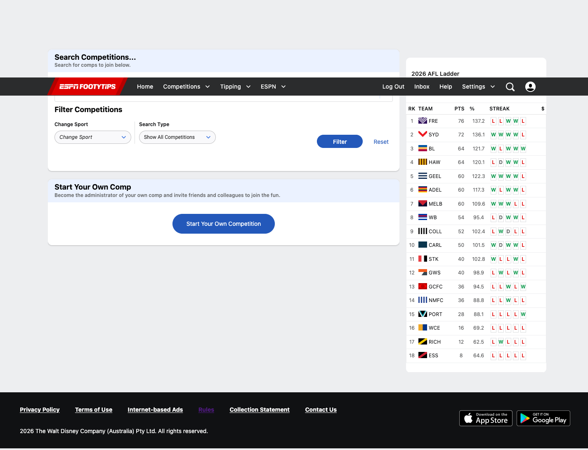

- **Purpose.** Discover public comps, or divert into creating your own.
- **Entry.** `Join Competition` on the landing page routes here (`?ff=searchcomp`) rather than to a join form [O].
- **Layout & components.** Card `Search Competitions…` with subline "Search for comps to join below." and a `Search by competition name` field; a second card `Filter Competitions` with two labelled selects (`Change Sport`, `Search Type` = `Show All Competitions`), a filled `Filter` button and a `Reset` text button; a third card `Start Your Own Comp` with the subline "Become the administrator of your own comp and invite friends and colleagues to join the fun." and a centred `Start Your Own Competition` button.
- **States.** No results are rendered in the default state — no rows, no empty-state copy, no "0 comps match". The screen is therefore dominated by the create-your-own card.
- **Responsive.** Cards stack; the two selects go full width; `Filter` and `Reset` stay on one row.
- **UX observations.** A search screen that renders nothing by default reads as broken rather than empty. The private-comp path (URL + password, evidenced in Settings) has no visible entry point here — there is no "enter comp code / password" field, so the only discoverable way into a private comp is the shared link [?].
- **Evidence vs inference.** Controls and the empty result area observed. That results require pressing `Filter` is [I].
- **Capture artefact.** The duplicated header mid-page is a sticky-header capture artefact.

### 08 — Competition: Ladder

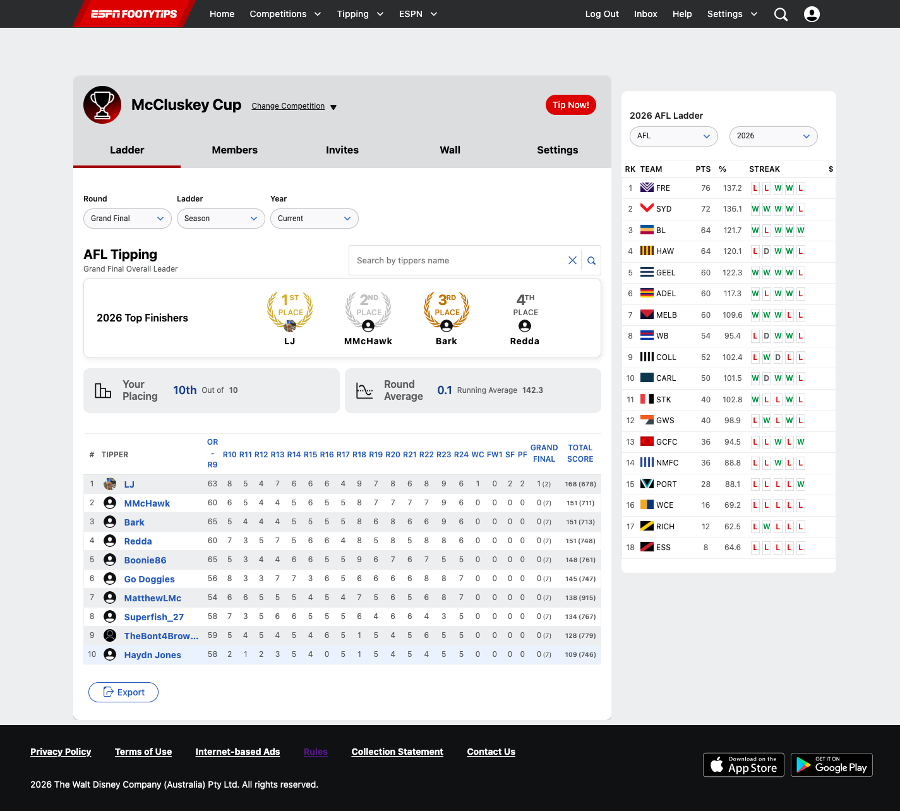

- **Purpose.** The competition's home tab: ranked standing per round, with the comp's identity and switch/enter-tipping controls above it.
- **Layout & components.** Comp shell card: grey header band with trophy crest, `McCluskey Cup` as title, an underlined `Change Competition` control and a red `Tip Now!` pill; a plain 5-item tab row (`Ladder · Members · Invites · Wall · Settings`) with a thin underline on the active tab; then the body — three labelled native selects (`Round` = Grand Final, `Ladder` = Season, `Year` = Current), an `AFL Tipping` heading with the subline `Grand Final Overall Leader`, a `Search by tippers name` field aligned right of the heading, a `2026 Top Finishers` card with four medal slots (`1ST PLACE` gold, `2ND`, `3RD`, `4TH`), two KPI tiles (`Your Placing 10th / Out of 10`, `Round Average 0.1` with `Running Average 142.3` inline), the ladder table, and an `Export` pill below it.
- **Table.** 22 columns: `#`, `TIPPER`, `OR - R9`, `R10`…`R24`, `WC`, `FW1`, `SF`, `PF`, `GRAND FINAL`, `TOTAL SCORE`. 10 rows, ranks 1–10. Tipper cells are avatar + underlined name; round cells are bare integers; final-series cells are mostly `0` with one bracketed pair (`1(2)`); totals render as a pair (`168 (678)`) with the parenthetical unexplained. Rows are zebra-striped, ~29px tall, 12px numerals.
- **States.** No sort affordance on any column — despite every header being a `<button>` in the DOM [O]. No "you" marker on the viewer's own row; the only way to find yourself is the KPI that says `10th`. No lockout, live or final indicator on any round column. Round `OR - R9` and `WC`…`PF` carry no legend.
- **Data integrity flag.** The comp has 25 members (Members tab) but the ladder renders 10 rows with no pagination, no page size and no "showing 10 of 25" copy — a third of the ladder is absent with nothing saying so [O]. `Round Average 0.1` next to `Running Average 142.3` is also unreconciled [?].
- **Responsive.** Mobile keeps 4 columns only (`#`, `TIPPER`, `GRAND FINAL`, `TOTAL SCORE`) and **drops** the 18 round columns with no scroll, no per-round card view and no notice. Filters become three stacked full-width selects placed above the page heading; the KPI tiles stack full width (which reads better — "Your Placing 10th Out of 10"); Top Finishers becomes a 2×2 grid; the rail disappears; the tab row overflows the viewport, clipping `Settings`.
- **UX observations.** The core object of the screen (round-by-round scores) is unreadable at 22 columns on desktop and entirely absent on mobile. `Export` below the table is the only action attached to the data.
- **Evidence vs inference.** Columns, counts, labels and values observed and re-verified in the DOM. Export format and pagination intent are [?].

### 09 — Competition: Members

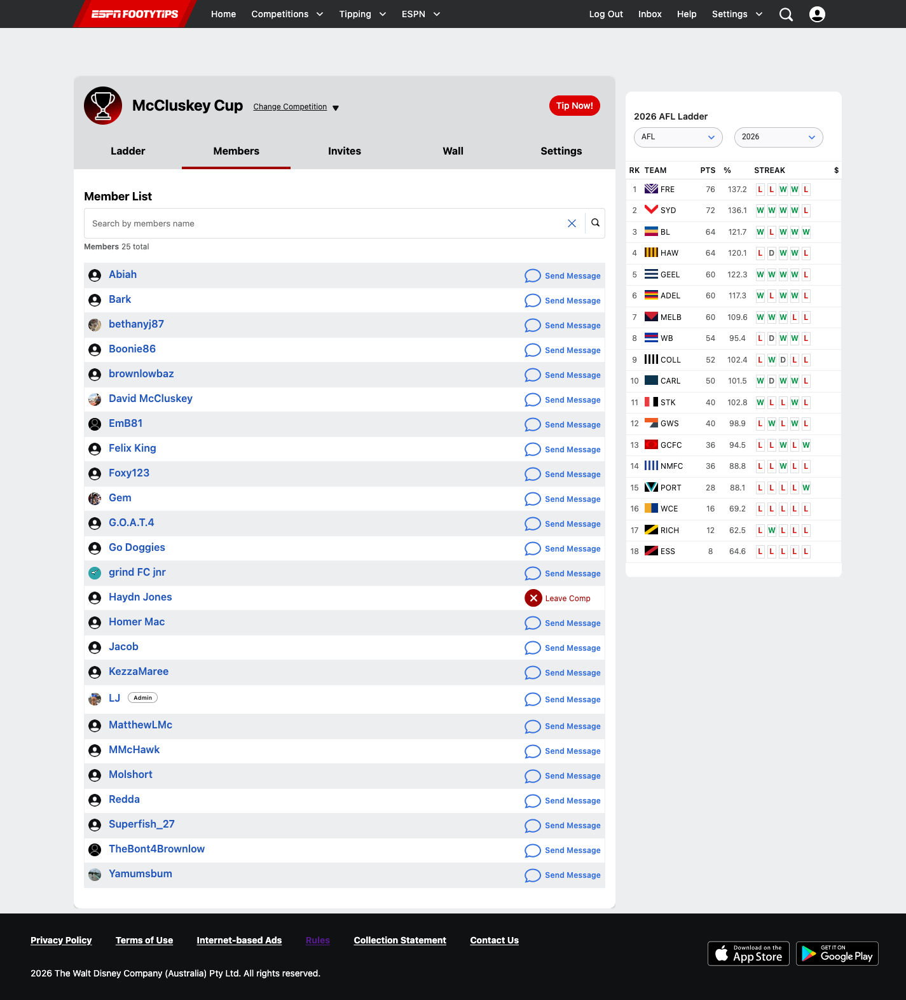

- **Purpose.** The comp roster.
- **Layout & components.** Identical shell. Body: `Member List` heading, a full-width `Search by members name` field with clear and magnifier controls, a meta line `Members 25 total`, then a single headerless list of 25 rows separated by hairlines — avatar, blue name link, and a per-row action on the right.
- **Data shown.** 25 rows, one of which carries a small outlined `Admin` pill after the name. 24 rows show a speech-bubble icon + `Send Message`; the signed-in player's own row substitutes a red circular cross + `Leave Comp`. No rank, points, join date or last-active column. The screenshots contain real members' names.
- **Actions & controls.** Search, 24 × `Send Message`, 1 × `Leave Comp`. Notably there is **no invite control here**, even though an `Invites` tab exists.
- **States.** No column headers at all, so the action column is only self-describing by repetition. No empty/no-results state, no loading state, no sort. Row treatment differs from the ladder table (hairlines + no zebra, 48px rows vs 29px).
- **Responsive.** Rows become separated cards; the action label wraps to two lines (`Send / Message`, `Leave / Comp`) and consumes ~90px of a 350px row, squeezing long names against the icon; the `Admin` pill crowds the name; `Settings` is clipped off the tab row.
- **UX observations.** A destructive action (`Leave Comp`) shares the same weight, size and position as 24 constructive ones on the viewer's own row, with no `You` label and no confirmation. This is the single highest mis-tap risk in the area.
- **Evidence vs inference.** Row count, pill, and action counts verified in the DOM (24 + 1). That `Send Message` opens a direct message is [I].

### 10 — Competition: Invites

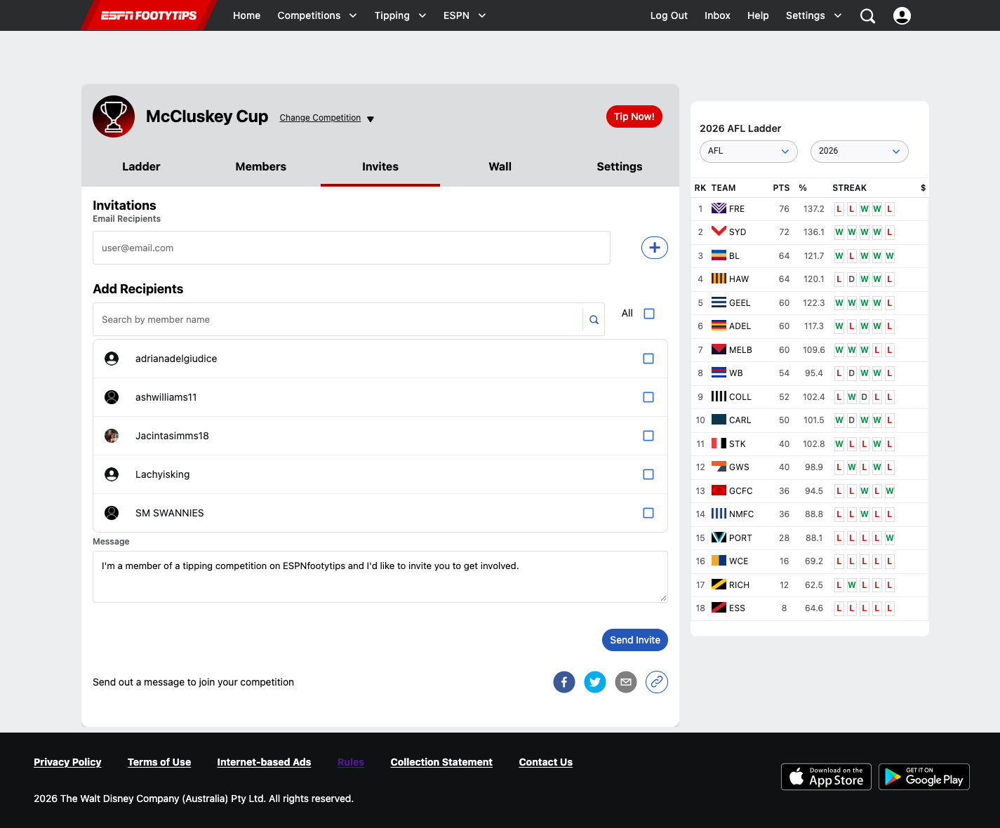

- **Purpose.** Bring people into the comp.
- **Layout & components.** Shell, then a single content column: `Invitations` heading → `Email Recipients` sub-label with an email input and a circular outlined `+` button → `Add Recipients` with a `Search by member name` field and a magnifier button, an `All` checkbox, and a bordered list of 5 existing friends (avatar, handle, checkbox) → `Message` label + textarea → filled `Send Invite` → a separate closure block, "Send out a message to join your competition", with four round icon buttons (Facebook, X, envelope, link).
- **Data shown.** Five friend handles, all unchecked; message textarea **prefilled**: "I'm a member of a tipping competition on ESPNfootytips and I'd like to invite you to get involved."
- **States.** `Send Invite` renders in full primary style with zero recipients selected — nothing is disabled or guarded. No recipient count, no invite history, no success or error surface, no per-row "already a member" marker.
- **Responsive.** Same order, stacked; the email field and `+` abut awkwardly; `All` and its checkbox float outside the search field's box; the message wraps to three lines; the share icons sit ungrouped near the footer.
- **UX observations.** Two invite metaphors (email entry, friend picker) share one card with no hierarchy or explanation of the difference. The share block duplicates the intent of `Send Invite` and reads as static text. Invite copy is written for the inviter ("I'm a member of…") but displayed to them for editing, which is unusual but workable.
- **Evidence vs inference.** Labels, prefilled copy, friend count and absence of counters verified in the DOM. Share-icon destinations are [?].

### 11 — Competition: Wall

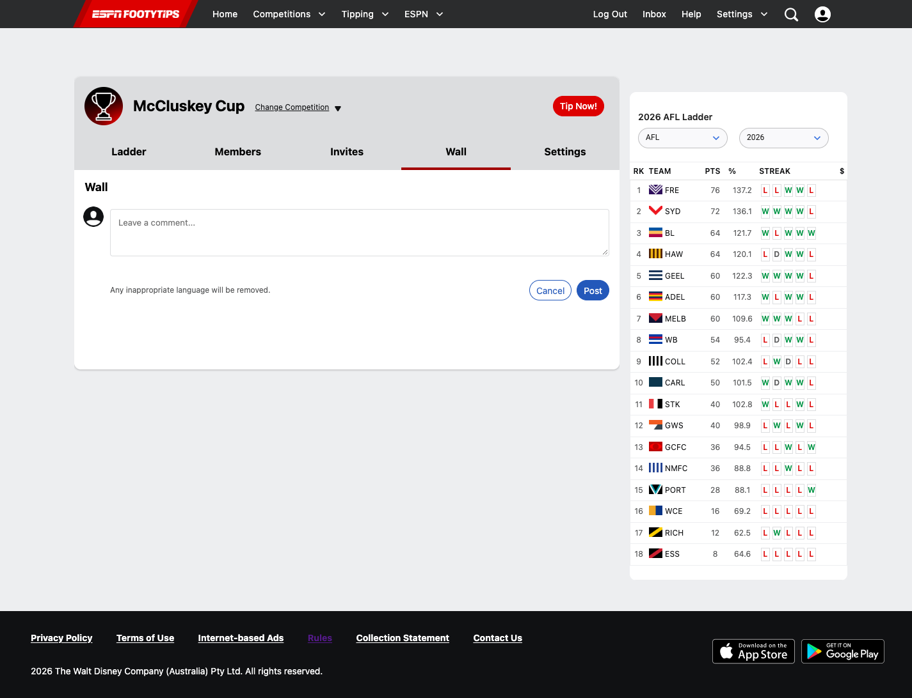

- **Purpose.** Comp-scoped message board for banter.
- **Layout & components.** Shell, then `Wall` heading and one composer row: circular avatar, `Leave a comment…` textarea, and a footer line with the helper "Any inappropriate language will be removed." on the left and `Cancel` (outlined) + `Post` (filled blue) on the right.
- **Data shown.** No posts. Zero entries from a 25-member comp.
- **States.** Empty feed with **no** empty-state copy — no "be the first to post", no illustration, no example. `Post` is fully enabled with an empty textarea; `Cancel` is present with nothing to cancel.
- **Responsive.** Avatar-left composition retained; helper text wraps and sits beside the two buttons; buttons grow to pill height; the composer sits below ~700px of chrome on a 844px viewport.
- **UX observations.** The only guidance on the screen is a moderation warning, so a first-time user meets a rule before a reason. With no posts, no counts and no activity, the wall cannot advertise its own value. The helper text shares a row with the buttons, so it reads like a label for `Cancel`.
- **Evidence vs inference.** Layout, placeholder and warning copy observed. Whether posts can be edited/deleted/notified is not evidenced.

### 12 — Competition: Settings

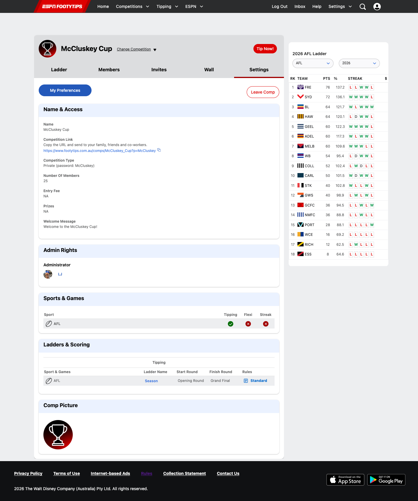

- **Purpose.** Comp configuration and membership exits.
- **Layout & components.** Shell, then a full-width action row (`My Preferences` blue, `Leave Comp` red-outlined), then five stacked panels each with a pale-blue title band: `Name & Access`, `Admin Rights`, `Sports & Games`, `Ladders & Scoring`, `Comp Picture`.
- **Data shown (label/value, rendered as plain text).** Name `McCluskey Cup`; `Competition Link` with helper "Copy the URL and send to your family, friends and co-workers." over `https://www.footytips.com.au/comps/McCluskey_Cup?p=McCluskey` plus a copy icon; `Competition Type` = `Private (password: McCluskey)` — **the password is printed in cleartext** to any member who opens Settings; `Number Of Members 25`; `Entry Fee NA`; `Prizes NA`; `Welcome Message` = the comp's welcome text; `Admin Rights` = `Administrator` + one avatar/initials; `Sports & Games` = a table `Sport / Tipping / Flexi / Streak` with one AFL row using tick/cross glyphs; `Ladders & Scoring` = a table `Sport & Games / Ladder Name / Start Round / Finish Round / Rules` with `AFL`, `Season` (link), `Opening Round`, `Grand Final`, `Standard` (link); `Comp Picture` = a trophy image.
- **States.** For this member everything is read-only — with no disabled styling, no lock icon and no "only the admin can change this" notice. The absence of edit controls is silent. `Leave Comp` has no visible confirmation guard at rest.
- **Responsive.** Panels keep their order; the `Ladders & Scoring` table does not adapt — `Finish Round` clips to `Finis` and `Grand Final` to `Gra` with no scroll affordance; the `Leave Comp` label clips to `Leave`; the invite URL wraps mid-token.
- **UX observations.** A member cannot distinguish "designed to be read-only" from "you lack permission". Printing the private comp's password here undermines the only access control the product has. `My Preferences` is placed above every panel rather than beside the settings it governs.
- **Evidence vs inference.** Every value above was read from the page. The admin's editable version of these panels is [I], not observed.

### 13 — My preferences (comp-scoped)

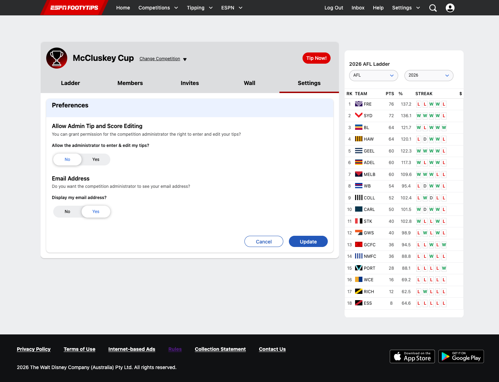

- **Purpose.** Member-level consent about what the comp administrator may do or see.
- **Layout & components.** Renders in place of the Settings content inside the comp shell, with `Settings` still the active tab and a `Preferences` title band. Two question blocks, each = heading + grey helper sentence + bold question + a 2-option segmented control in a rounded track; footer `Cancel` (outlined) + `Update` (filled).
- **Questions.** `Allow Admin Tip and Score Editing` / helper "You can grant permission for the competition administrator the right to enter and edit your tips?" / control `Allow the administrator to enter & edit my tips?` — currently `No`. And `Email Address` / helper "Do you want the competition administrator to see your email address?" / control `Display my email address?` — currently `Yes`.
- **States.** Both answered; no unset state; `Update` enabled; no unsaved-changes indicator; no success confirmation observed. No dimmed backdrop and no close control — it reads as a nested page, not a modal, so the only exits are `Cancel` and browser back [I].
- **UX observations.** One question is stated three times in three voices (heading, helper, control label). A consent decision is rendered as a segmented toggle, which reads like a filter. Two adjacent Yes/No pairs with opposite defaults (`No` then `Yes`) invite mis-taps, and the consequence of granting tip-editing rights is never explained.
- **Evidence vs inference.** Copy and selected values observed. Enforcement of these flags at tip time is [I].

### 14 — Site ladder

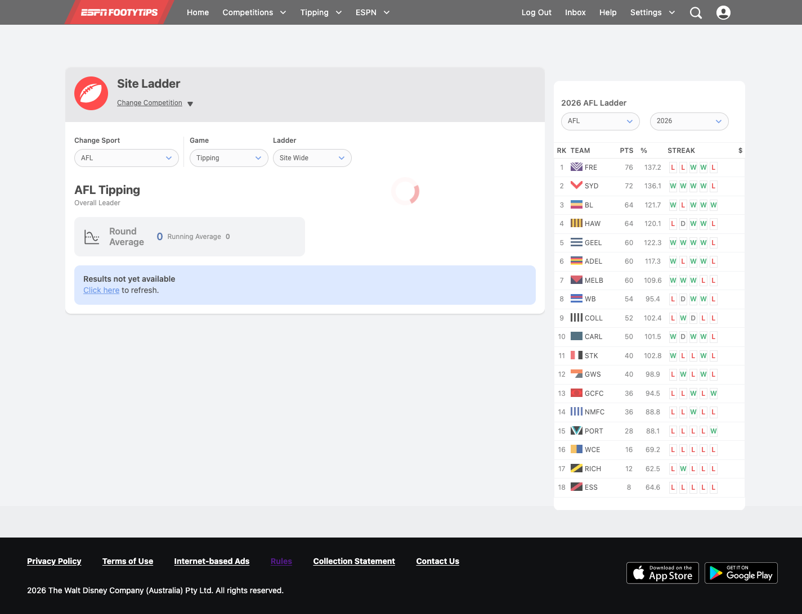

- **Purpose.** The global ladder every player is automatically on.
- **Layout & components.** A shell *without* the comp tab row: red AFL ball crest instead of the trophy, `Site Ladder` title, `Change Competition` control beneath it, then a filter row of three labelled selects (`Change Sport` = AFL, `Game` = Tipping, `Ladder` = Site Wide), an `AFL Tipping` heading with subline `Overall Leader`, a stat card with a line-chart glyph showing `Round Average 0` / `Running Average 0`, and a blue info banner `Results not yet available` / `Click here to refresh.`
- **States.** Simultaneous loading and failure: a pink spinner is still animating while the "not available" banner is already displayed [O]. No ladder rows, no skeleton, no explanation of why. The right rail's `2026 AFL Ladder` is fully populated (18 teams), so the failure is isolated to the site ladder [O].
- **Actions & controls.** Three selects, `Change Competition`, the refresh link. No pagination, no round selector, and no way back into a comp except the global nav.
- **Responsive.** Not captured at mobile [?].
- **UX observations.** Two headings for one thing (`Site Ladder` then `AFL Tipping`), a stat strip rendering `0` where the number is unknown, and a `Change Competition` control on a page that is definitionally not a comp. This is the least finished screen in the area and the one a new player is most likely to hit first, since the site ladder is their default comp.
- **Evidence vs inference.** Banner, spinner, zero values and filter defaults observed. Whether the empty state is permanent or transient is [?].

## 5. User roles & permissions

Two roles are named in the UI [O]:

| Role | Evidence | What it can do | Gaps |
|---|---|---|---|
| **Member** (every player) | Reviewed account is a member of comp 384349, not its admin | Views ladder, members, wall, settings (read-only fields), can invite, can post to the wall, controls own `My Preferences`, can `Leave Comp` | Whether a member can post unlimited times, edit or delete their own posts, or see other members' emails [?] |
| **Administrator** | `Admin Rights` → `Administrator` names one member | Presumably edits name/access, sports, ladders & scoring, picture, and holds the invite/member controls | The admin edit affordances were **not capturable** on this account: every settings field rendered as static text. What the form looks like for an admin is [?] |
| **Site-wide player** | `ESPNfootytips Overall Site Ladder` card with `Comp Rank 772,697 of 934,551` | Automatic membership, no leave control visible | Join/leave semantics of the global comp [?] |

Deliberately not determined: whether the administrator is unique or plural (the
UI says `Administrator`, singular, and shows one name), whether admin rights can
be delegated, and whether a member-level permission ("allow the administrator to
enter & edit my tips") is enforced per member at tip time [I — the dialog implies
per-member consent stored against the comp].

## 6. Key user flows

### F1 — Create a competition
1. Entry: `Create Competition` on `/competitions` (header band) or the
   `Create Competition` outline button below the news carousel.
2. Step 1 `Name & Access`: name, URL slug, optional picture, Public/Private,
   entry fee yes/no, prizes yes/no, welcome message → `Next Step`.
3. Step 2 `Pick Your Sports`: pick at least one sport (validation copy
   `Please choose a sport`) → `Next Step`.
4. Step 3 `Pick Your Games`: pick at least one mode (Tipping/Flexi/Streak).
5. Step 4 `Custom Scoring`: answer `Add custom scoring?` → `Create Comp`.
6. Success signal: unknown — the final submit was deliberately not exercised [?].
7. Branches/dead ends: `Previous step` returns to the last step; state is not
   URL-addressable, so a refresh or back-navigation loses progress [I]. The step
   navigation is a linear stepper with no jump-to-step.

### F2 — Find and join a competition
1. Entry: `Join Competition` button on `/competitions` (it routes to
   `?ff=searchcomp`, not to a join form) [O].
2. Screen offers `Search by competition name`, `Change Sport`, `Search Type`
   (`Show All Competitions`), `Filter` and `Reset`.
3. No results rendered in the captured state [O] — either the default filter
   returns nothing or results require pressing `Filter` [?].
4. Alternative path offered on the same screen: `Start Your Own Comp` →
   `Start Your Own Competition`.
5. Dead end: joining a private comp needs a URL + password, and no
   "enter password / enter comp code" field is visible here [?].

### F3 — Create and start a wall post
1. `Wall` tab → `Leave a comment…` textarea.
2. `Post` publishes, `Cancel` clears. Success signal not captured (posting was
   not exercised) [?].

### F4 — Invite someone
1. Two entries: `INVITE` on a comp card, and the `Invites` tab.
2. `Add Recipients`: type an email, or tick existing friends filtered by
   `Search by member name`, all-selectable via `checkAll`.
3. Optional message textarea, then `Send Invite`.
4. Success signal not captured; whether invites can be revoked, and whether an
   invite list/history exists, is not evidenced [O: no list of sent invites on
   the screen].

### F5 — Member leaves a comp
1. `Settings` tab → `Leave Comp` → confirm (`Leave`).
2. The confirm control exists in the DOM; the confirmation copy was not read
   because triggering it risks a destructive action [O for the control, ? for
   the copy].

## 7. Domain entities & data model

**Whole section inferred [I]** — derived from visible fields and URL params.

```
Player        id (userloc), display name, initials avatar, email (consent-gated),
              site rank / site total, favourite sport(s), sports being tipped
Comp          id (competitionId), slug/url, name, picture, type {public|private},
              password (private only), welcome message, entry fee {NA|amount},
              prizes {NA|yes}, memberCount, createdAt?, administrator (Player)
Ladder        id (ladderId), compId, sport, season, name ("Season"),
              startRound ("Opening Round"), finishRound ("Grand Final"),
              rules ("Standard" | custom)          ← one comp can hold >1 ladder [I]
CompMembership  compId, playerId, joinedAt?, role {member|administrator},
              allowAdminTipEditing {yes|no}, showEmail {yes|no}
Sport         group + code (AFL, AFL Women's, NBA, NRL, …), isFavourite, isTipping
GameMode      {Tipping | Flexi | Streak} — per comp, per sport
Round         season, code (OR, R1..R24, WC, FW1, SF, PF, GRAND FINAL), order
Score         membershipId, roundCode, points, cumulative   ← the ladder cells
WallPost      compId, authorId, body, createdAt  (no reactions/attachments visible)
Invitation    compId, inviterId, recipient {email|playerId}, message, sentAt, status?
```

Relationships: a `Player` has many `CompMembership`s; a `Comp` has one or more
`Ladder`s and many `Membership`s; `Score` joins membership × round. The URL
carries three identifiers at once — `competitionId`, `ladderId`, `userloc` —
which is why the ladder, not the comp, is the addressable unit [O].

Enumerations observed [O]: comp type `Public | Private`; membership role
`Administrator | Member`; `Entry Fee: NA | value`; `Prizes: NA | value`; game
mode `Tipping | Flexi | Streak`; ladder `Rules: Standard`.

## 8. Integrations & third-party services

- **Google DoubleClick ad units** [O] — the competitions list contains
  `pubads.g.doubleclick.net/gampad/clk?...iu=/21783347309/espn.footytips.nondart`
  links wrapped around prize values; ad serving is part of the list layout.
- **Disney/ESPN identity and legal surfaces** [O] — footer links to
  `privacy.thewaltdisneycompany.com`, `disneytermsofuse.com/australia-newzealand`,
  `preferences-mgr.truste.com` (ad preferences), and a Disney collection notice.
- **ESPN editorial content** [O] — the `AFL Latest` carousel is branded
  `NEWS AND STORIES BY ESPN` and is feed-driven with 9+ pagination dots.
- **App distribution** [O] — App Store (`id335530215`) and Google Play
  (`com.espnau.footytips`) badges in the footer.
- **Email delivery for invites** [I] — implied by `Send Invite` with an email
  field; provider unknown [?].
- **Image upload/moderation for comp pictures** [I] — implied by the "subject to
  approval" copy; storage/CDN unknown [?].
- **Single sign-on** [I] — `Log Out` in the global header with no in-product
  login form visible; ESPN account assumed [?].

## 9. Cross-cutting patterns

- **Query-string state model** [O]: every comp tab is `?ff=…` (`createcomp`,
  `searchcomp`, `members`, `invites`, `wall`, `settings`). Tabs are therefore
  deep-linkable and survive refresh — but the create wizard's *step* is not in
  the URL, so wizard progress does not.
- **Three coexisting nav layers** [O]: global header (Home/Competitions/Tipping/
  ESPN/Inbox/Help/Settings), a sport segmenter (`AFL`, `2026`), and a comp tab
  row (`Ladder · Members · Invites · Wall · Settings`). On the ladder the same
  row is repeated as a second set of `Round / Ladder / Year` dropdowns.
- **One widget repeated everywhere** [O]: the `2026 AFL Ladder` rail appears on
  all seven comp screens and on the create/search screens, always with `AFL`
  and `2026` selects.
- **Empty and first-run states** [O]: the create wizard has an empty comp-picture
  slot with a trophy glyph; the search screen renders no results; the KPI values
  are numeric zeros (`Round Score 0/1`) rather than an empty-state message.
- **Validation style** [O]: inline red text directly beneath the field plus a red
  border; no summary, no `aria-describedby` relationship verified.
- **Date/units conventions** [O]: rounds are labelled by code not date
  (`R10`, `GRAND FINAL`); news dates render as `11 NOV 2026`; numbers use
  thousands separators (`381,983 of 934,551`).
- **Locale/i18n** [O]: Australian English throughout; no language switcher.
- **Naming drift** [O]: four names for one action — `Create Competition` (the
  visible header-band button and the closing CTA), `Create Comp` (the wizard's
  final submit), `Start Your Own Competition` (search screen), and, in the DOM
  alongside the header-band button, a control labelled `Create Comptition`
  (misspelled) that is not visibly rendered in the capture. `Join Competition`
  likewise means "open the search screen", not "join".

## 10. Responsive & feature-parity notes

Mobile (390×844) is a collapse of the desktop layout, not a separate experience.

- **Global header** [O]: nav links collapse to a hamburger; only logo and avatar
  remain. Search becomes an icon.
- **Right rail removed entirely** [O]: the `2026 AFL Ladder` widget and,
  critically, the ladder-tab KPI blocks (`2026 Top Finishers`, `Your Placing`,
  `Round Average`) do not appear on mobile at these breakpoints.
- **Search pattern changes type** [O]: desktop uses a `Search Competitions…`
  input in the header band; mobile shows a `Search Competition` *button* in the
  same slot, so search costs an extra tap.
- **Comp cards** [O]: four KPI tiles wrap 3-up with `Total Score` dropping to a
  full-width fourth row; the `INVITE` affordance disappears from the mobile card
  (still reachable via the Invites tab) [O].
- **Create wizard** [O]: the stepper keeps all four labels but wraps them onto
  two lines; the sports grid collapses from 2–3 columns to one; `Previous step`
  stays full-width and adjacent to `Next Step`, which keeps the primary action
  reachable at the end of a very long page (≈4,200px tall on step 2 and step 3).
- **Footer** [O]: six links reflow into a two-column list; store badges go
  full-width-ish below.
- **Feature parity gaps worth flagging** [O]: the desktop rail KPI data is absent
  on mobile, and the card-level `INVITE` shortcut is absent on mobile.

## 11. UX quality assessment

Observations only — this is not a WCAG audit.

**Status visibility.** The comp card answers "where am I?" well: round score,
round rank, comp rank and total score sit in one glanceable block [O]. But the
card does not say whether tips are open, locked or pending for the current round
— `Round Score 0/1` is ambiguous between "you missed one" and "one fixture hasn't
started" [?]. The ladder's round columns are the only place progress is legible.

**Recognition over recall.** Strong on the wizard's step 2 and 3, where each
option carries a one-line description (`Flexi` explains flexi-points and odds;
`Streak` explains the reset rule) [O]. Weak on the ladder, which uses round codes
(`WC`, `FW1`, `SF`, `PF`) with no legend — a new player must decode finals
shorthand [O].

**Consistency.** Four different labels for create [O] (§9). `View Tips` is a red
filled button on the list while the primary create action is blue — two primary
colours competing in the same band [O].

**Error prevention.** The wizard validates required fields only on `Next Step`
and only inline [O]; nothing marks the fields as required beforehand, and the
`Next Step` button is never disabled. Cheap and recoverable, but the user
discovers requirements by failing.

**Feedback.** No success state was observable for create/join/invite/post because
submitting was out of scope [?]. Invites and wall posts have no visible
confirmation surface in the captured DOM.

**Accessibility observations** [O unless marked]:
- Form controls on the settings screen are plain text, not disabled inputs, so
  there is nothing focusable to read for a member — the read-only state is not
  announced.
- Segmented controls (Public/Private, Yes/No) are custom components without
  visible radio semantics — a screen reader user may hear buttons only [?].
- The ladder's `STREAK` column conveys W/L/D by colour plus a letter, which is
  the better pattern; the KPI tiles convey up/down rank by a coloured triangle
  **only** — colour-only meaning in the one place it matters most [O].
- Tap targets on mobile: the `INVITE` link and the `Show More` pill are small
  text affordances below 44px height [O, measured visually].
- The wizard's stepper is purely visual; completed steps carry no checkmark and
  no `aria-current` was observed [?].

**Friction list, ranked.**
1. Ladder is the comp's landing tab but carries no "what do I do next" affordance
   — the actionable CTA (`Tip Now!`) sits in the page header, visually detached
   from the table [O].
2. Round codes without a legend on the ladder's column headers [O].
3. Search-and-join screen renders no results in its default state, leaving
   `Start Your Own Competition` as the only visible action [O].
4. Create wizard state is lost on refresh/back because the step is not in the URL
   [I].
5. The `Add Recipients` picker mixes two invite metaphors (email entry + friend
   checkboxes) in one card without prioritising either [O].

## 12. Reverse-engineering scope

### Must build [O]
- Competitions list: per-sport band, one card per comp with four KPIs
  (`Round Score`, `Round Rank`, `Comp Rank`, `Total Score`), inline invite
  affordance, `Show More` overflow.
- Global/site-wide comp card presented in the same list, ranked against a total
  population (`381,983 of 934,551`).
- Four-step create wizard with stepper, unsaved-state progression, inline
  validation on advance.
- Comp name + custom slug with fixed URL prefix; comp picture upload with format
  and size constraints and an approval queue.
- Public/Private with password for private; entry-fee and prizes declarations.
- Sport multi-select across 14 competitions in 9 groups, with favourite/tipping
  legend.
- Game modes: Tipping, Flexi, Streak.
- Comp shell with five tabs, URL-addressable (`?ff=`): Ladder, Members, Invites,
  Wall, Settings.
- Ladder: per-round columns (incl. finals codes), sortable headers, round /
  ladder / year filters, tipper search, export.
- Members: roster with names, search, count.
- Invites: email recipient, friend picker with select-all, message, send.
- Wall: comment composer with post/cancel.
- Settings: name & access, admin rights (single named administrator), sports &
  games matrix, ladders & scoring matrix, comp picture; member-level
  `My Preferences` (admin tip editing, email visibility); `Leave Comp` with
  confirmation.

### Strongly implied [I]
- Invite delivery by email, and an invite status/acceptance model (nothing on
  screen lists sent invites).
- Password-based private-comp join flow, entered from a comp URL
  (`/comps/<Slug>?p=<password>`), which implies a join-by-link screen.
- Per-member permission flags enforced at tip time (the `My Preferences` dialog
  only makes sense if the server honours them).
- Ladder configuration beyond one default ladder (`Ladders & Scoring` is a table,
  and `ladderId` is a separate identifier from `competitionId`).
- Score computation per round per member, since the ladder renders one cell per
  member per round.
- Image moderation for comp pictures.
- An ads layer inside the comp list.

### Uncertain [?]
- What the admin sees on Settings — inputs, save model, and whether changes are
  immediate (member account only).
- Whether `Export` produces CSV, Excel or a share sheet.
- Whether `Create Comp` can fail partially, and what the success screen is.
- Whether wall posts are editable/deletable, threaded, or notified.
- Whether a comp can span multiple seasons or be renewed.
- Whether the ladder's 10 visible rows are a page size, a top-10 cut, or
  `Show More`-driven (the comp has 25 members and the table reported 10 rows).
- Whether `Custom Scoring = Yes` opens a scoring editor or a rules document.

### Not evidenced
Member removal/kick, admin transfer, join requests/approval, comp deletion,
comp archiving, season rollover, wall notifications/reactions, invite revocation,
paid comps or entry-fee collection, comp-level analytics, audit log of admin
changes, any bulk action on members.

### Complexity flags
- **RBAC** — member vs administrator, plus per-member consent flags.
- **Multi-tenancy** — every entity is scoped by `competitionId` and the ladder by
  `ladderId`; three IDs in one URL.
- **Billing/prizes** — entry fee and prizes are declared fields with no payment
  surface; regulated if money ever moves.
- **Gambling adjacency** — `Flexi` explicitly multiplies points by betting odds;
  any clone in a non-betting product must not ship this mode as-is.
- **Uploads + moderation** — comp pictures.
- **Email** — invite delivery.
- **Ads** — inventory embedded in the list layout.
- **i18n** — none; Australian English and Sydney-market leagues hard-coded.
- **Realtime** — none observed on wall or ladder; refresh-based.

### Open questions for a human
1. Is competition membership **per sports code** (one master card per code) or
   per comp? The ESPN model appears per comp — every comp card carries its own
   `Round Score`. MberX has already decided the opposite; this audit cannot be
   copied wholesale on that point.
2. Does the ladder show tips before lockout, or only scores after?
3. What is the admin's actual Settings form, and is there a second admin role?
4. How does a private comp's password reach an invitee, and can it be rotated?
5. Are the per-member consent flags (`allow admin to edit my tips`) a product
   requirement worth copying, or an artefact of an older, less trustworthy
   product?

## 13. Capture log

All times 18 Nov 2026, Australia/Sydney. Browser: Chrome (user's paired profile,
logged in). Desktop viewport 1440×900, mobile emulated 390×844 with
`deviceScaleFactor: 2` and touch on. Full-page captures (`fullPage: true`).
Read-only: no form was submitted, no invite sent, no post published, no comp
created, no download triggered.

| Time | Screen | Route | Viewport | File | Source | Notes |
|---|---|---|---|---|---|---|
| 06:35 | Competitions landing | `/competitions` | desktop | `01-competitions-landing-desktop.png` | captured | — |
| 06:38 | Competitions landing | `/competitions` | mobile | `01-competitions-landing-mobile.png` | captured | — |
| 06:36 | Create step 1 | `?ff=createcomp` | desktop | `02-create-competition-step1-desktop.png` | captured | — |
| 06:39 | Create step 1 | `?ff=createcomp` | mobile | `02-create-competition-step1-mobile.png` | captured | — |
| 06:36 | Create step 1 validation | `?ff=createcomp` | desktop | `03-create-competition-step1-validation-desktop.png` | captured | interaction: clicked `Next Step` with both required fields empty |
| 06:36 | Create step 2 sports | `?ff=createcomp` | desktop | `04-create-competition-step2-sports-desktop.png` | captured | interaction: filled dummy name + slug (never submitted), clicked `Next Step`, ticked `AFL` |
| 06:39 | Create step 2 sports | `?ff=createcomp` | mobile | `04-create-competition-step2-sports-mobile.png` | captured | same interaction, re-run at mobile width |
| 06:36 | Create step 3 games | `?ff=createcomp` | desktop | `05-create-competition-step3-games-desktop.png` | captured | interaction: advanced one step |
| 06:40 | Create step 3 games | `?ff=createcomp` | mobile | `05-create-competition-step3-games-mobile.png` | captured | interaction: ticked `AFL` with forced click (an SVG overlay covered the input at mobile width) |
| 06:36 | Create step 4 scoring | `?ff=createcomp` | desktop | `06-create-competition-step4-scoring-desktop.png` | captured | `Create Comp` deliberately **not** clicked |
| 06:40 | Create step 4 scoring | `?ff=createcomp` | mobile | `06-create-competition-step4-scoring-mobile.png` | captured | `Create Comp` deliberately **not** clicked |
| 06:37 | Find a comp to join | `?ff=searchcomp` | desktop | `07-search-competitions-desktop.png` | captured | reached via `Join Competition`; no results rendered |
| 06:38 | Find a comp to join | `?ff=searchcomp` | mobile | `07-search-competitions-mobile.png` | captured | — |
| 06:37 | Comp ladder | `/competitions/afl/ladder?competitionId=384349…` | desktop | `08-comp-ladder-desktop.png` | captured | — |
| 06:38 | Comp ladder | same | mobile | `08-comp-ladder-mobile.png` | captured | — |
| 06:37 | Comp members | `…&ff=members` | desktop | `09-comp-members-desktop.png` | captured | — |
| 06:38 | Comp members | `…&ff=members` | mobile | `09-comp-members-mobile.png` | captured | — |
| 06:37 | Comp invites | `…&ff=invites` | desktop | `10-comp-invites-desktop.png` | captured | no invite sent |
| 06:38 | Comp invites | `…&ff=invites` | mobile | `10-comp-invites-mobile.png` | captured | — |
| 06:37 | Comp wall | `…&ff=wall` | desktop | `11-comp-wall-desktop.png` | captured | no post published |
| 06:38 | Comp wall | `…&ff=wall` | mobile | `11-comp-wall-mobile.png` | captured | — |
| 06:37 | Comp settings | `…&ff=settings` | desktop | `12-comp-settings-desktop.png` | captured | member view, fields read-only |
| 06:38 | Comp settings | `…&ff=settings` | mobile | `12-comp-settings-mobile.png` | captured | — |
| 06:38 | My preferences dialog | `…&ff=settings` + `My Preferences` | desktop | `13-comp-my-preferences-modal-desktop.png` | captured | opened then dismissed with `Cancel` |
| 06:38 | Site ladder | `/competitions/afl/siteladder?userloc=772697` | desktop | `14-site-ladder-desktop.png` | captured | — |

Failures and gaps:
- **Admin views not captured.** The session is a **member** of comp 384349, not
  its administrator. Settings therefore rendered read-only and the admin-only
  edit/invite-management affordances are unobserved. Flagged in §5 and §12.
- **`Leave Comp` confirmation** was not opened — triggering a destructive dialog
  was out of scope; the `Leave` control is visible in the DOM only.
- **`Export`** was not clicked (it is a download side effect).
- **Custom scoring editor** is behind `Add custom scoring? → Yes` on the final
  wizard step, i.e. behind the submit — not captured.
- **Duplicate header artefact:** in `03-…validation-desktop.png` and
  `07-search-competitions-desktop.png` the global header appears a second time
  mid-page. This is a sticky-header artefact of the full-page capture, not a UI
  defect; do not rebuild it that way.
- **Emulation caveat:** mobile viewports were produced by resizing/emulating in
  Chrome, not by a real device. Layout breakpoints changed; user-agent-dependent
  behaviour (and any app-specific mobile redirect) did not.
