# ESPN FootyTips — UX & Scope Analysis (A-League Tipping)

> Source: https://footytips.espn.com.au/tipping/aleague · Captured: 16 Nov 2026, ~12:23–12:42 AEDT
> Viewports: desktop 1440×900 · mobile 390×844 (narrow-window render, DPR 1, no device emulation)
> Screens: 1 route, 16 captured states · Evidence: [O] observed · [I] inferred · [?] unknown

Agreed plan (from intake): this route only, its immediately visible child states, both viewports, quick pass, session already authenticated.

Primary capture: `screens/01-aleague-tipping-mobile.png` (390×844, full page, 3227 px tall) and `screens/10-aleague-tipping-desktop.png` (1440×900, full page, 2598 px tall).

---

## 1. Product summary

ESPN FootyTips is a free-to-play sports tipping competition site operated under the ESPN Australia / The Walt Disney Company (Australia) umbrella. `footytips.espn.com.au/tipping/aleague` is the tipping entry screen for the **A-League Men** code. A logged-in participant picks a winner (or a draw) for every fixture in the round, nominates a winning margin for one designated match, and submits. Scoring is 1 point per correct tip; rankings break ties on round margin, then cumulative margin. [O] (rules page read in-session)

The screen is a single-column task surface on mobile: a competition switcher, a game-mode switcher, round navigation, then a chronological list of fixtures grouped by date, then byes, notification/favourite-team preferences, a submit button, and an ESPN news carousel. On desktop the same column is centred at 852 px with a persistent right sidebar carrying a live A-League ladder. [O]

Three game modes sit behind the same fixture list: **Tipping** (classic, with the margin picker and submission card), **Flexi** (an "Flexi Points 100/100 Remaining / Points awarded" economy), and **Streak** ("Best Streak", "Current Streak", "Overall Rank"). Each mode has its own URL and its own tip-distribution percentages for the same fixtures. [O]

Business signals: no pricing, no wagering or cash-out language, no paywall. Odd-looking decimal prices (`$1.68`, `$4.09`, `$4.25`) sit next to each outcome alongside community tip percentages — they read as market odds supplied for context rather than as something the user can stake. [I] The only commercial prompts are the App Store / Google Play badges in the footer, and a news module badged "NEWS AND STORIES BY ESPN". [O]

Maturity: shipped, responsive, Material-UI based, with a full legal rules page, 14 supported codes, and a live ladder. It carries visible defects (see §11) including team names that exist only as CSS-generated content.

---

## 2. Screen inventory

| # | Screen / state | Route | Purpose | Viewport captured | Screenshot |
|---|---|---|---|---|---|
| 1 | Tipping — default | `/tipping/aleague` | Pick outcomes for Matchweek 5 | mobile, desktop | `01-aleague-tipping-mobile.png`, `10-aleague-tipping-desktop.png` |
| 2 | Header / top block | same | Mode + round + score context | mobile, desktop | `02-aleague-header-mobile.png`, `11-aleague-top-desktop.png` |
| 3 | Fixture card + margin game | same | Three-way outcome selection, margin input | mobile, desktop | `03-aleague-match1-mobile.png`, `04-aleague-margin-mobile.png`, `12-aleague-matches-desktop.png` |
| 4 | Outcome selected | same | Selection affordance | mobile | `24-aleague-tip-selected-mobile.png` |
| 5 | Byes + preferences + submit | same | Notifications, favourite team, submission | mobile | `05-aleague-byes-prefs-mobile.png`, `06-aleague-submit-mobile.png` |
| 6 | News carousel + footer | same | Editorial + legal + app downloads | mobile, desktop | `07-aleague-news-mobile.png`, `08-aleague-footer-mobile.png`, `13-aleague-bottom-desktop.png`, `13b-aleague-footer-desktop.png` |
| 7 | "How to play" modal | same (overlay) | Two-paragraph mechanic explainer | mobile | `09-aleague-how-to-play-mobile.png` |
| 8 | Read rules / scoring page | `/tipping?ff=howtoplay` | Full scoring table + Rules of Play | mobile | `14-aleague-read-rules-mobile.png` |
| 9 | Flexi mode | `/tipping/aleague/flexi?round=5` | Points-budget tipping variant | mobile | `15-aleague-flexi-mobile.png` |
| 10 | Streak mode | `/tipping/aleague/streak?round=5` | Consecutive-correct-tips variant | mobile | `16-aleague-streak-mobile.png` |
| 11 | Sport selector open | same | 14-code competition switcher | mobile | `17-aleague-sport-selector-mobile.png` |
| 12 | Joker modal | same (overlay) | Joker-round eligibility explainer | mobile | `18-aleague-joker-mobile.png` |
| 13 | Favourite team selector open | same | 12-team dropdown | mobile | `19-aleague-favourite-team-mobile.png` |
| 14 | "Show Tip Info" toggled on | same | Toggle state | mobile | `20-aleague-show-tip-info-mobile.png` |
| 15 | Margin help modal | same (overlay) | Explains margin scoring | mobile | `21-aleague-margin-help-mobile.png` |
| 16 | Mobile navigation drawer | same (overlay) | Icon rail + sports list | mobile | `23-aleague-hamburger-menu-mobile.png` |

---

## 3. Core functionality map

### Tipping (primary)
- **Fixture list by round** [O] — cards grouped under date headings: Fri 20 Nov (1), Sat 21 Nov (3), Sun 22 Nov (1). Each card header is `time • venue` (e.g. `7:40 PM • CommBank Stadium`); `MATCH CENTRE` in the footer bar opens an external match view in a new tab [? destination blocked].
- **Three-way outcome selection** [O] — radio group per match: home (left edge), draw (centre column), away (right edge). Tapping a team half selects it and tints that half pale blue (`screens/24`). Values are team ids (`1161`, `500`) and `0` for draw (`input[name="matches.N.selectedTeam"]`).
- **Margin game** [O] — appears on the first fixture only. Label `By what margin?`, quick chips `0 2 4 6 8` (desktop), a stepper `− [1] +`, and a `?` help control that opens the "What is the margin?" dialog.
- **Tip distribution + odds** [O] — each outcome shows a decimal price (`$1.68`) and a share percentage (`86%`); shares are colour-keyed (home deep blue, draw amber, away red) and a proportional two-segment bar beneath the row repeats the home/away split.
- **Round navigation** [O] — `‹ Matchweek 4` / `A-League Men Matchweek 5` / `Matchweek 6 ›`; URLs accept `?round=5`.
- **Round status** [O] — `Last Round 0/6`, `Total Score 0`, amber banner `Matchweek 5 starts in 4 days`.
- **Quick Tip** [O present / [?] behaviour] — blue pill with a check icon above the fixture list. Not clicked during the audit because it is likely to write tips.
- **Submission** [O] — red full-width `Submit Tips` in the preferences card. Button is **not** disabled with zero tips selected (`disabled: false` both before and after selecting one outcome).

### Game modes
- **Tipping / Flexi / Streak segmented control** [O] — path-based modes (`/tipping`, `/flexi`, `/streak`), all preserving `?round=`. Flexi adds `Flexi Points 100/100 Remaining` and `Points awarded 0`; Streak adds `Best Streak 0`, `Attempt`, `Overall Rank -%`, `Current Streak 0`.
- **Mode-scoped tip percentages** [O] — same fixture reads 86/5/9 in Tipping, 79/8/12 in Flexi, 89/5/6 in Streak, i.e. each mode aggregates its own participants.
- **Mode-scoped chrome** [O] — the margin picker, preferences card, `Submit Tips`, `Joker` and `Show Tip Info` were present in Tipping and absent from the Flexi/Streak text runs.

### Competition switching
- **Sport selector** [O] — `role="button"` with `aria-label="Sport Selector"`, opens a 14-item listbox: AFL, NRL, Super Rugby, A-League Men, Premier League, Champions League, Football World Cup, NBL, NFL, T20 Big Bash League, NBA, Super Netball, AFL Women's, NRL Women's.

### Personalisation & notifications
- **Favourite team** [O] — `aria-label="Favourite Team Selector"`, placeholder `Please select a team`, 12 options: Adelaide United, Auckland FC, Brisbane Roar, Central Coast Mariners, Macarthur FC, Melbourne City, Melbourne Victory, Newcastle Jets, Perth Glory, Sydney, Wellington Phoenix, Western Sydney.
- **Five notification checkboxes** [O] — `Reminder Emails`, `Results Emails`, `Reminder Notifications`, `Results Notifications`, `Tip Record Emails`, all unchecked, submitted as form fields `remindersEmails`, `resultsEmails`, `remindersAppNotifications`, `resultsAppNotifications`, `EMAILTIPRECORD`.
- **Show Tip Info** [O present / [?] effect] — switch next to `Joker`; toggling produced no observable change to card text or percentage count in this state.
- **Joker** [O] — opens `Set Joker Rounds`: "You are not in any competitions with Joker rounds. … In Joker rounds, your correct tips are doubled. Joker rounds only apply to private competitions". Points admins to `Settings > Ladders & Scoring > Create a Ladder`.

### Reference content
- **How to play** modal [O] — `Pick the result` and `Choose a margin` only.
- **Read rules** page [O] — `/tipping?ff=howtoplay`: scoring matrix for 14 codes (A-League Men: 28 rounds, default tips = Away Team(s), max default score 2, draws allowed, 1 pt win / 0 loss / 1 draw) plus the full Rules of Play, including "Registration is open to Australian residents aged 18 years or older" and "free … except for any normal internet or mobile connection charges".
- **Ladder** [O] — desktop sidebar card titled `2026-27 A-League Men Ladder` with `A-League Men` and `2026-27` selectors and columns RK / TEAM / PTS / F/A / STREAK (12 rows: WEL 10 +6, SYD 7 +3, BRI 7 +2, MCY 7 0, PER 6 +3, WSW 5 +2, MAC 5 0, AFC 5 −1, MVC 3 −1, NEW 2 −4, CCM 2 −5, ADL 1 −5).
- **News carousel** [O] — `A-League Men Latest` + `NEWS AND STORIES BY ESPN` lockup; an active-dot pagination row; article cards with image, headline, `09 NOV 2026` date, and a summary paragraph on desktop.

### Navigation & account
- Desktop header: `ESPN FOOTYTIPS` logo · Home · Competitions ▾ · Tipping ▾ · ESPN ▾ · Log Out · Inbox · Help · Settings ▾ · search icon · avatar. [O]
- Mobile header: hamburger · logo · avatar only. Drawer holds an icon rail (Search, Home, Comps, Tipping [active], ESPN, Help, Inbox, Settings, Account, Log Out) and a `My Sports` / `More Sports` list of the same 14 codes. [O]

---

## 4. Screen-by-screen analysis

### 4.1 Tipping — A-League Men (default state)

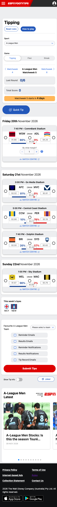
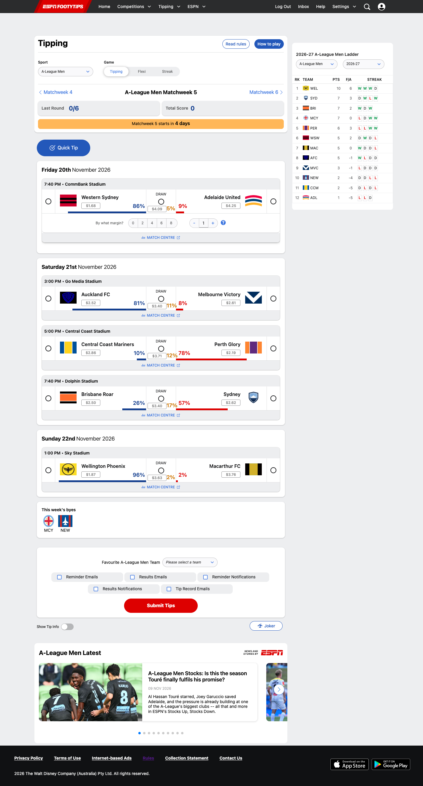

**Purpose.** Single surface for entering a round of A-League Men tips.
**Primary goal.** Select an outcome for each of five fixtures and submit before lockout.

**Layout & components.** Mobile: 375 px document width, 16 px gutters, 343 px content column. Header 44 px tall. Order: `Tipping` (h1, ~29 px) → `Read rules` (outlined) + `How to play` (filled) → `Sport` select → `Game` segmented control → round nav → two stat rows → amber countdown bar → `Quick Tip` → five fixture cards in three date groups → byes card → preferences card → `Show Tip Info` + `Joker` row → news module → black footer.

Desktop: 1440 px viewport, 1425 px document width, main column x=287 w=852, right ladder sidebar occupying roughly x≈1146–1420 (274 px). Header expands to the full nav described above.

**Data & entities.** Competition (A-League Men), round (Matchweek 5), fixtures, teams (logo + name), decimal prices, tip-share percentages, user's last-round score (0/6) and total score (0).

**Actions & controls.** Sport select, game-mode toggle, prev/next round, `Quick Tip`, per-match radio selection, margin chips/stepper, `MATCH CENTRE`, byes (read-only), favourite-team select, five checkboxes, `Submit Tips`, `Show Tip Info`, `Joker`.

**States.** Empty (no tips entered, 0/6) renders no empty-state messaging — the list simply shows unselected radios. Selected state tints the chosen half blue and fills the radio (`screens/24`). Locked/results states were not reachable at this date (round starts in 4 days, 0/6 last round). [?]

**Navigation.** Round links mutate `?round=`; mode links mutate the path; the sport selector swaps the code and keeps you on `/tipping/<code>`.

**UX observations.** The score strip (`Last Round 0/6`, `Total Score 0`) is visually subordinate to the round title and carries no round label, so it is ambiguous whether `0/6` belongs to the round named in the header or to the previous one. `Quick Tip` sits before the fixture list, so its purpose (auto-fill? submit?) is not inferable from the label alone. Five fixtures are rendered for the round; `0/6` cannot be this round's denominator because six fixtures are not on screen.

**Evidence vs inference.** Layout numbers and copy are [O]. `Quick Tip` behaviour and locked/result states are [?]. That `0/6` refers to Matchweek 4 is [I] from adjacency to `< Matchweek 4`.

---

### 4.2 Header / top block

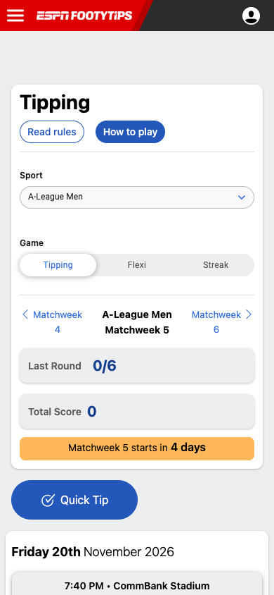
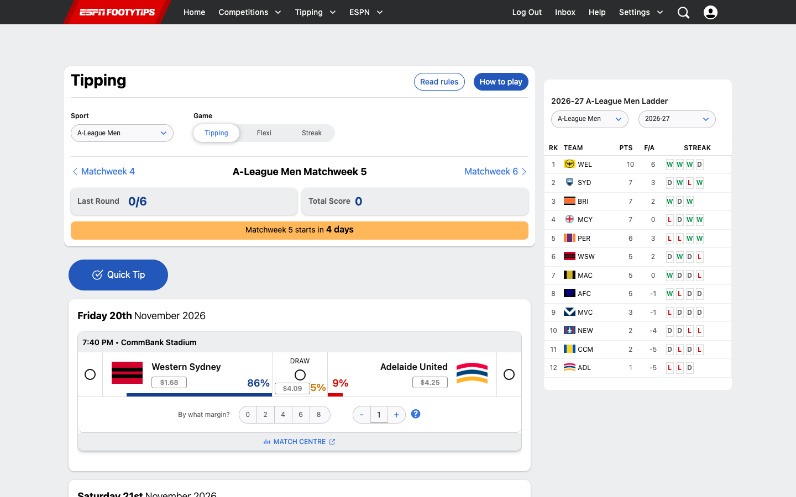

**Purpose.** Establish mode, round and standing before the pick list.
**Components.** `Tipping` heading; `Read rules` (outlined, blue); `How to play` (filled blue); `Sport` label + select showing `A-League Men`; `Game` label + three-way segmented control with `Tipping` selected (white pill); round nav with chevrons; `Last Round` row with `0/6`; `Total Score` row with `0`; amber bar `Matchweek 5 starts in 4 days`.
**Observations.** `Read rules` and `How to play` are adjacent but behave differently — `Read rules` navigates to `/tipping?ff=howtoplay`, `How to play` opens an overlay. Same-weight siblings with different mental models. [O]
**Responsive.** Identical content at both widths; desktop places the two help buttons top-right of the panel, mobile stacks them under the heading. [O]

---

### 4.3 Fixture card + margin game

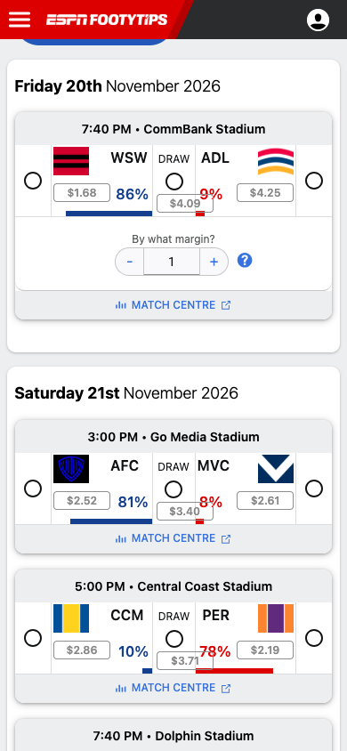
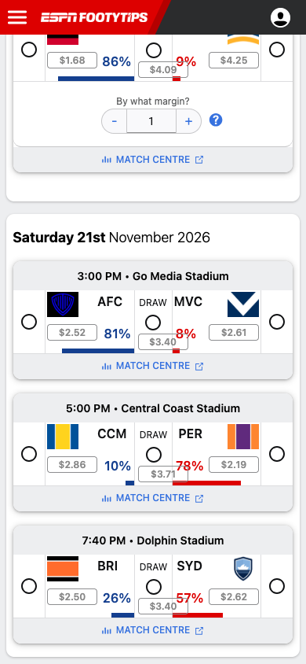
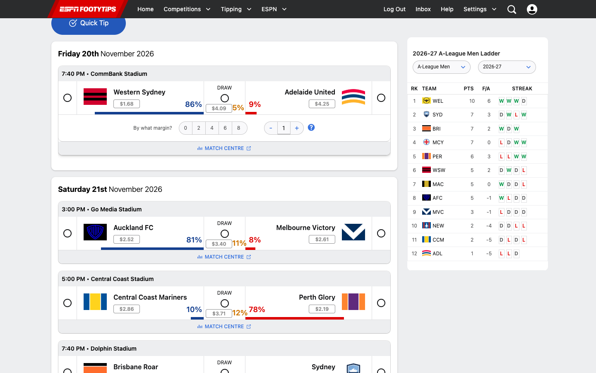

**Purpose.** Capture one three-way prediction per fixture, plus a margin for the designated match.
**Structure (mobile).** Card header `7:40 PM • CommBank Stadium`; body split into home half / draw column / away half; each half carries a team logo (40×32), a team label, a small price chip (64×21 px) and a percentage with a proportional bar; radios at left edge, centre and right edge (40×80 px hit area). Footer bar: bar-chart icon + `MATCH CENTRE` + external-link icon.
**Margin row.** Present on the first fixture only: `By what margin?` label, stepper (`−`, numeric field defaulting to `1`, `+`, 128×32 px) and a `?` control. Desktop additionally exposes quick chips `0 2 4 6 8`; mobile hides them. [O]

| Fixture (A-League Men Matchweek 5) | Home | Draw | Away |
|---|---|---|---|
| Fri 20 Nov, 7:40 PM, CommBank Stadium | Western Sydney `$1.68` 86% | `$4.09` 5% | Adelaide United `$4.25` 9% |
| Sat 21 Nov, 3:00 PM, Go Media Stadium | Auckland FC `$2.52` 81% | `$3.40` 11% | Melbourne Victory `$2.61` 8% |
| Sat 21 Nov, 5:00 PM, Central Coast Stadium | Central Coast Mariners `$2.86` 10% | `$3.71` 12% | Perth Glory `$2.19` 78% |
| Sat 21 Nov, 7:40 PM, Dolphin Stadium | Brisbane Roar `$2.50` 26% | `$3.40` 17% | Sydney `$2.62` 57% |
| Sun 22 Nov, 1:00 PM, Sky Stadium | Wellington Phoenix `$1.87` 96% | `$3.63` 2% | Macarthur FC `$3.76` 2% |

**Data & entities.** Fixture id (embedded in DOM ids such as `marginWesternSydney_AdelaideUnited56607`), team id (`1161`, `500`, `0` = draw), decimal price, share percent, margin integer.
**Observations.** Only one fixture in the round carries a margin input, but nothing in the interface marks it as *the* margin game — the row appears under fixture 1 with no heading, badge or explanation beyond the `?` dialog. [O] Each price is a `<button>` nested inside the radio's `<label>`, so pressing it selects the outcome rather than doing anything price-specific; the button styling still reads as a separate control. [I]
**Responsive.** Desktop shows the quick-margin chips and full team names; mobile drops the chips and abbreviates team names (`WSW`, `ADL`, `AFC`, `MVC`, `CCM`, `PER`, `BRI`, `SYD`, `WEL`, `MAC`). [O]

---

### 4.4 Outcome selected

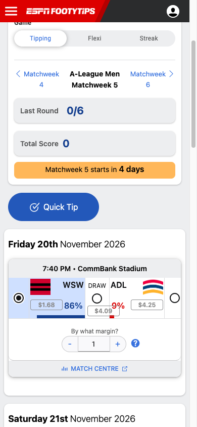

Selecting the home half fills the left radio, tints the home half pale blue, leaves the draw column and away half grey, and keeps the margin row and `MATCH CENTRE` bar unchanged. `Submit Tips` does **not** change disabled state (`disabled: false` before and after). No per-match confirmation, no count of tips remaining, no scroll to the submit control. [O]

---

### 4.5 Byes, preferences and submission

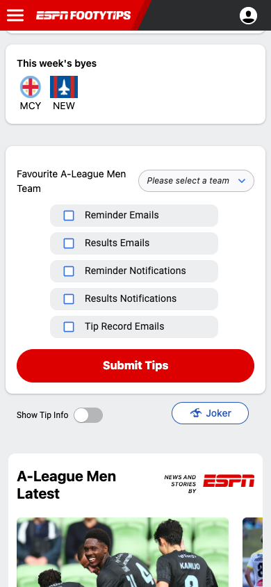
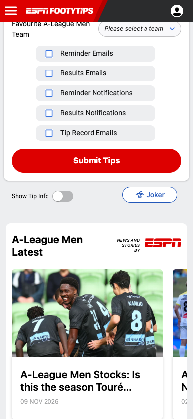

**Byes card.** Heading `This week's byes`; two badge tiles with club crests and labels `MCY`, `NEW` (Melbourne City, Newcastle Jets). Read-only. [O]
**Preferences card.** `Favourite A-League Men Team` label with a select showing `Please select a team`; five full-width checkbox rows in pill containers (`Reminder Emails`, `Results Emails`, `Reminder Notifications`, `Results Notifications`, `Tip Record Emails`); red `Submit Tips` pill spanning the card (327×48 px on mobile, fixed width centred on desktop). [O]
**Observations.** Notification consent is bundled into the same card as tip submission, so submitting tips also implies a notification-preference decision the user has not necessarily considered. Labels use "Emails" and "Notifications" as parallel channels with no explanation of the difference. [I] No success, error or validation feedback was observable without submitting. [?]

---

### 4.6 News module and footer

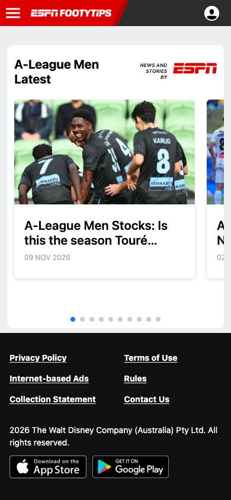
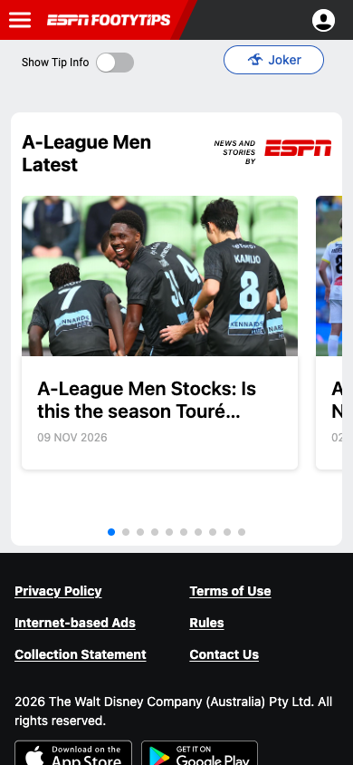
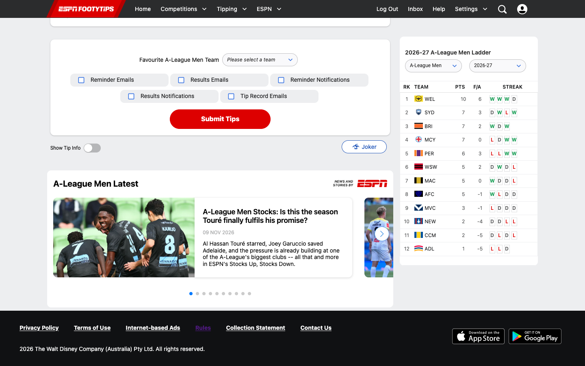
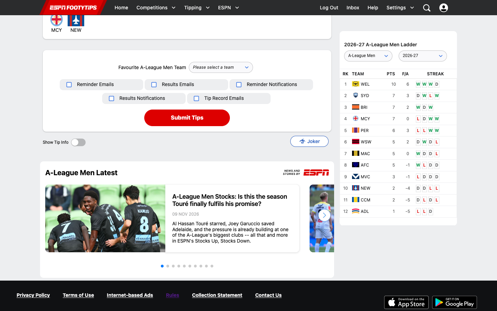

**News.** `A-League Men Latest` heading, `NEWS AND STORIES BY ESPN` lockup, horizontally scrolling cards (image, headline, `09 NOV 2026`, summary on desktop), an active-dot pagination row, prev/next arrows (36×36). Publishes on the tipping route, i.e. editorial sits inside a task surface. [O]
**Footer.** Black band; two-column link list on mobile (`Privacy Policy`, `Terms of Use`, `Internet-based Ads`, `Rules`, `Collection Statement`, `Contact Us`), all underlined white; `2026 The Walt Disney Company (Australia) Pty Ltd. All rights reserved.`; App Store and Google Play badges linking to `apps.apple.com/au/app/footytips-footy-tipping-app/id335530215` and `play.google.com/store/apps/details?id=com.espnau.footytips`. [O]

---

### 4.7 "How to play" modal

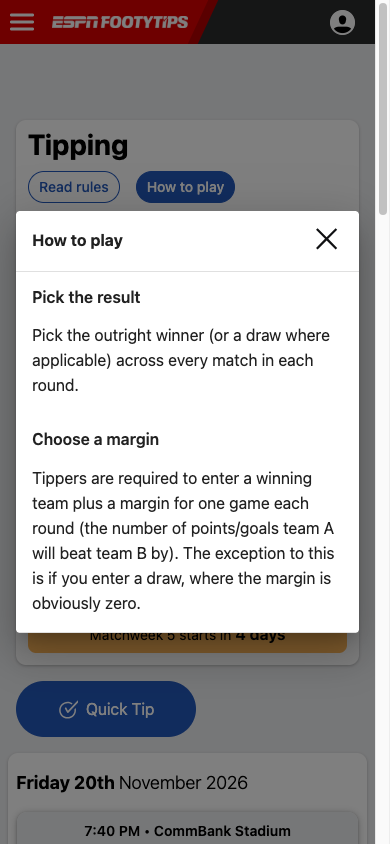

MUI dialog, 343 px wide inside a 390 px viewport (no horizontal overflow). Title `How to play`. Two sections: `Pick the result` — "Pick the outright winner (or a draw where applicable) across every match in each round."; `Choose a margin` — "Tippers are required to enter a winning team plus a margin for one game each round (the number of points/goals team A will beat team B by). The exception to this is if you enter a draw, where the margin is obviously zero." [O]

Contains no `<button>`; the dismiss control is an SVG `X` and `Escape` closes it. [?] keyboard focus trap behaviour.

---

### 4.8 Read rules / scoring page

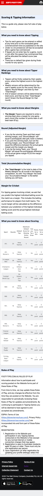

Route `/tipping?ff=howtoplay`, 4189 px tall on mobile. Opens with `Scoring & Tipping Information` ("This is a guide only, please view full rules of play below."), then `What you need to know about Tipping`, `… about Tipper Rankings`, `… about Margins` (round-adjusted and cumulative margin maths), `… about Scoring` (14-row table of rounds, default tips, max default score, draw eligibility, points), then `Rules of Play` legal text.

Key rules captured: tips editable until each match's scheduled start; margins required for one game per round and must be zero for a draw; ranking by weekly score → round margin → total margin; A-League Men = 28 rounds, default tips are away teams, maximum default score 2, draws permitted, 1/0/1 points; draws/cancellations with no result within three days are treated as a win for both teams; registration free, Australian residents 18+, one registration per person. [O]

---

### 4.9 Flexi mode

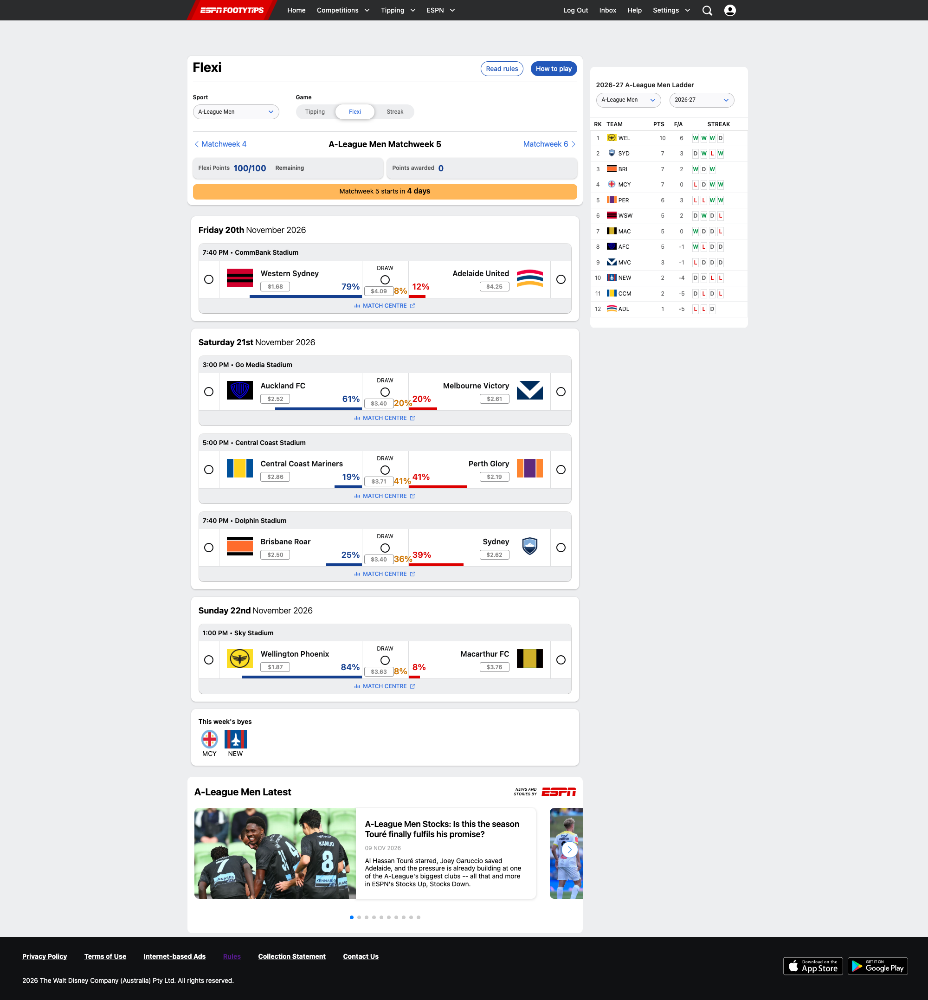

Route `/tipping/aleague/flexi?round=5`, 2107 px tall. Header swaps `Tipping` → `Flexi` and adds `Flexi Points 100/100 Remaining` and `Points awarded 0` in place of `Last Round` / `Total Score`. Same five fixtures with different percentages (79/8/12, 61/20/20, 19/41/41, 25/36/39, 84/8/8). No margin picker, no preferences card, no `Submit Tips`, no `Joker` in the rendered text. A `2026-27 A-League Men Ladder` block *does* render on mobile here, immediately after the news list. [O]

**Unknown.** How points are allocated, what "100/100" caps, and what commits a Flexi entry (no submit control was present). [?]

---

### 4.10 Streak mode

Route `/tipping/aleague/streak?round=5`, 2172 px tall. Header swaps to `Streak` with `Best Streak 0`, `Attempt`, `Overall Rank -%`, `Current Streak 0`. Percentages again differ (89/5/6, 91/5/4, 14/6/80, 24/12/64, 97/2/1). Same absence of margin/preferences/submit, and the ladder renders on mobile here too. [O]

`Overall Rank -%` on a fresh attempt implies a rank only exists once a streak is live. [I]

---

### 4.11 Sport selector

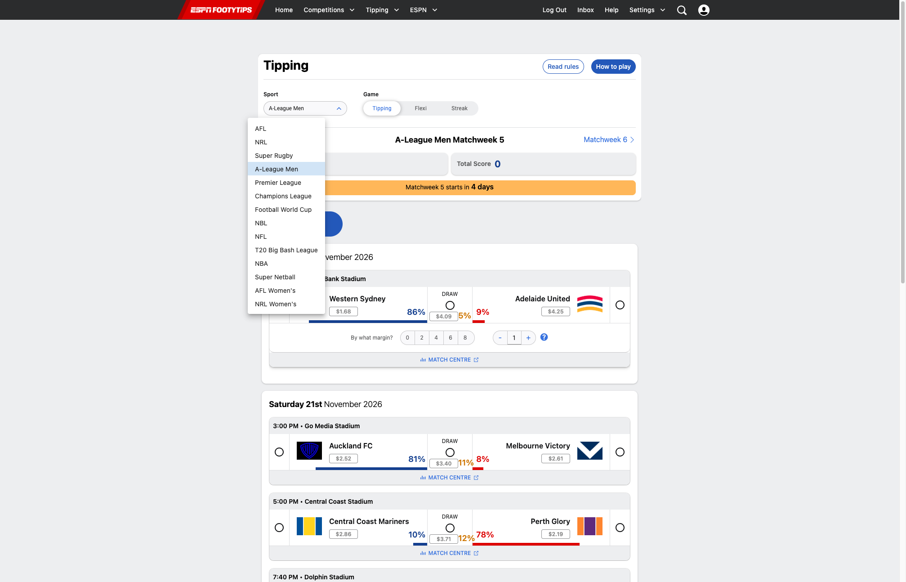

Listbox with 14 rows in the order AFL, NRL, Super Rugby, A-League Men, Premier League, Champions League, Football World Cup, NBL, NFL, T20 Big Bash League, NBA, Super Netball, AFL Women's, NRL Women's. Ordering is neither alphabetical nor grouped by sport, and mixes men's/women's codes at the end. [O]

---

### 4.12 Joker modal

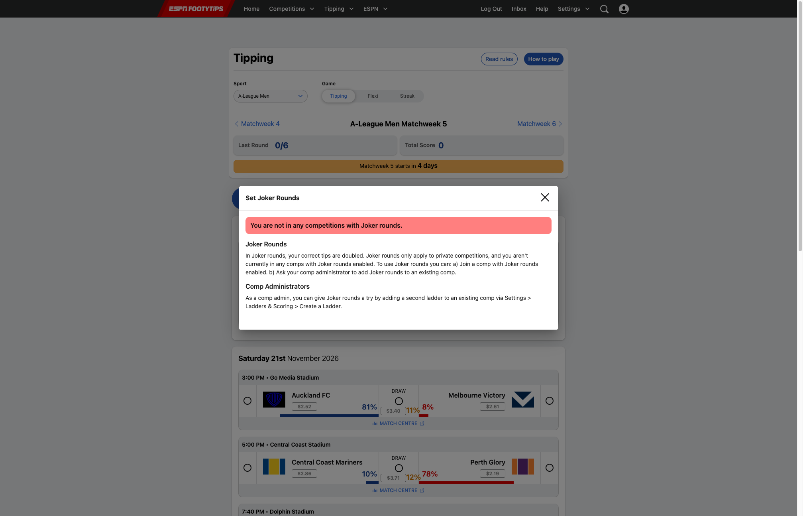

`Set Joker Rounds` dialog: "You are not in any competitions with Joker rounds." / "In Joker rounds, your correct tips are doubled. Joker rounds only apply to private competitions, and you aren't currently in any comps with Joker rounds enabled." Offers two remedies (join a comp with Joker rounds, or ask a comp admin) and an administrators' note: "you can give Joker rounds a try by adding a second ladder to an existing comp via Settings > Ladders & Scoring > Create a Ladder." [O]

Suggests a whole private-competition layer (comps, ladders, scoring settings, admin tooling) that this route never exposes. [I]

---

### 4.13 Favourite team selector

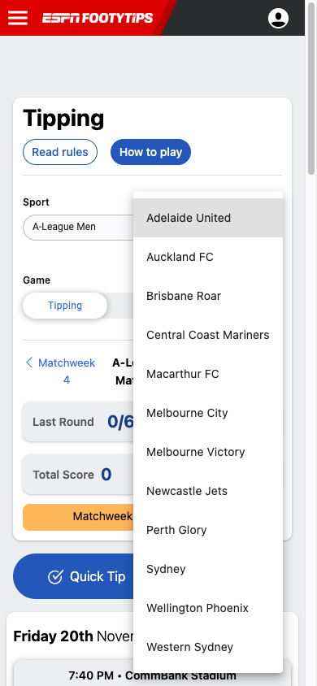

12 options as listed in §3. Club naming is inconsistent across the page: this dropdown and the fixture cards use `Sydney` and `Western Sydney` (no "FC"/"Wanderers"), the ladder uses three-letter codes (`SYD`, `WSW`), the byes tiles use codes only (`MCY`, `NEW`), and `Melbourne City` appears in full here but never on a fixture card in this round. [O]

---

### 4.14 "Show Tip Info" toggle

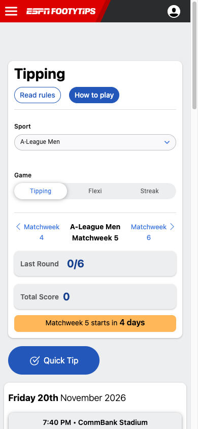

Switch rendered off. Toggling produced no change in card text length, percentage count or dialog state in this un-tipped state. The control has no `name`, no `id` and no associated `<label>` element (its visible text sits in a sibling `div`). [O] Effect is [?].

---

### 4.15 Margin help modal

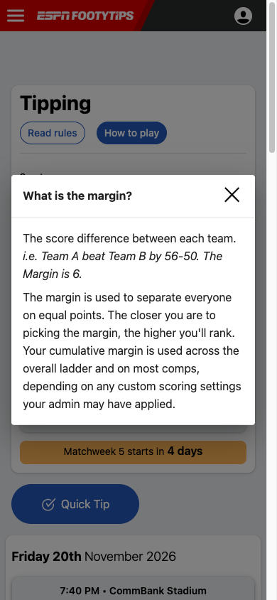

Title `What is the margin?`: "The score difference between each team. i.e. Team A beat Team B by 56-50. The Margin is 6." / "The margin is used to separate everyone on equal points. The closer you are to picking the margin, the higher you'll rank. Your cumulative margin is used across the overall ladder and on most comps, depending on any custom scoring settings your admin may have applied." [O]

This is the only on-screen explanation that the margin is a tiebreaker rather than part of the score. It is reachable only through an unlabelled `?` glyph. [O]

---

### 4.16 Mobile navigation drawer

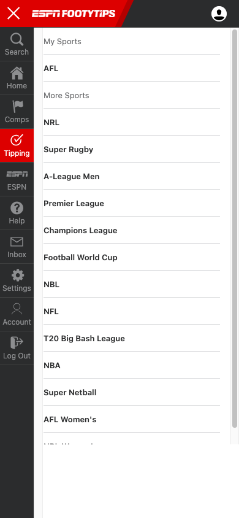

Slide-in panel: left icon rail (Search, Home, Comps, Tipping highlighted red, ESPN, Help, Inbox, Settings, Account, Log Out) plus a list panel headed `My Sports` (AFL) and `More Sports` (NRL, Super Rugby, A-League Men, Premier League, Champions League, Football World Cup, NBL, NFL, T20 Big Bash League, NBA, Super Netball, AFL Women's, NRL Women's). Drawer locks body scroll (`scrollHeight` collapses to the viewport). [O]

The `Tipping` rail item is the only highlighted entry, so the drawer doubles as a "where am I" indicator but shows no round or competition context. [I]

---

## 5. User roles & permissions

- **Logged-in participant** [O] — header shows `Log Out` and an avatar; tips, preferences and submission are available. Not in any Joker-enabled comp [O].
- **Comp administrator** [I] — referenced in the Joker dialog (adds Joker rounds via `Settings > Ladders & Scoring > Create a Ladder`); no admin surface was reachable from this route.
- **Signed-out visitor** [?] — not captured; the session was already authenticated, so what an anonymous visitor sees on `/tipping/aleague` is unknown.
- **Multi-comp membership** [I] — copy refers to "comps you are in", and scoring "on most comps, depending on any custom scoring settings your admin may have applied", implying per-comp overrides of global scoring.
- **Gated actions** [?] — whether tips can be edited after lockout, and what the page looks like post-lockout, is not evidenced.

---

## 6. Key user flows

**A. Enter and submit a round of tips**
1. Arrive at `/tipping/aleague` (defaults to Tipping mode, current round).
2. Confirm competition in `Sport`, mode in `Game`.
3. For each of five fixtures, tap a half (home/away) or the centre radio (draw).
4. On the first fixture, optionally tap a quick margin or use `− / +`.
5. Optionally set favourite team and notification checkboxes.
6. Tap `Submit Tips`. Success signal: unknown [?] — no toast or state change was observed pre-submission.

**B. Move between rounds**
`‹ Matchweek 4` → previous round (score 0/6 stored as `Last Round`), `Matchweek 6 ›` → future round. Each hop replaces the fixture list; the URL gains `?round=N`. [O]

**C. Switch game mode**
Segmented control swaps path to `/flexi` or `/streak`, preserving `?round=`, and replaces the score strip with mode-specific metrics while keeping the same fixtures. [O]

**D. Switch competition**
`Sport` → listbox → choose code. 14 codes available. [?] whether a code without an active round renders an empty state.

**E. Understand the margin rule**
Ambiguous margin row → tap `?` → read `What is the margin?`. Alternative path: `How to play` → `Choose a margin`, or `Read rules` → `What you need to know about Margins`. [O]

**F. Attempt a Joker round**
`Joker` → `Set Joker Rounds` → dead end with two remediation options. Flow dead-ends for a user in no Joker-enabled comp. [O]

**G. Open match detail**
`MATCH CENTRE` → new tab. Destination unknown; blocked in this environment. [?]

---

## 7. Domain entities & data model

*Whole section inferred from UI and copy; no API was inspected.*

| Entity | Fields seen | Relationships |
|---|---|---|
| Code / Competition | name (`A-League Men`), rounds count (28), default-tip rule, max default score (2), draw allowed (true), points win/loss/draw | has many Rounds; belongs to a sport |
| Sport | grouping of codes shown as `My Sports` / `More Sports` in the mobile drawer; analytics payloads expose `sport=soccer` for A-League | has many Codes |
| Round / Matchweek | number (5), starts-in countdown, lockout per fixture | has many Fixtures; belongs to Code |
| Fixture | kickoff (`7:40 PM`), venue (`CommBank Stadium`), date group, home team, away team, decimal prices ×3, tip shares ×3, `MATCH CENTRE` target | has many Tips; may be the round's Margin Game |
| Team | id (`1161`), full name (`Western Sydney`), abbreviation (`WSW`), crest URL (`.../aleague/rectangle/2x/1161.png`) | home/away of Fixture; appears in Ladder and byes |
| Tip | selectedTeam (`1161` / `0` / `500`), margin (integer 0–n), submitted flag | belongs to User and Fixture |
| Margin Game | the single fixture carrying a margin input; `margin<Home>_<Away><fixtureId>` | one per Round |
| Ladder | season (`2026-27`), rows: rank, team, points, for/against, last-4 streak | scoped to Code + Season |
| Comp (private competition) | Joker rounds enabled/disabled, custom scoring settings, ladders | user membership; admin role |
| News article | headline, date, summary, image | tagged to Code |
| User preferences | favourite team, 5 notification flags | belongs to User |

**Statuses observed.** Round upcoming (countdown banner), fixture un-tipped; `0/6` last round. **Statuses implied but unseen:** locked, live, resulted, void, bye, postponed. [?]

**Identifiers.** `input[name="matches.N.selectedTeam"]` (N = fixture index, ordinal), value = team id, `0` = draw; `?round=5`; `marginWesternSydney_AdelaideUnited56607` embeds team names plus a fixture id.

---

## 8. Integrations & third-party services

- **Auth/identity:** `login.disney.com/en-US/AU/ESPN-FOOTYTIPS.WEB/v5/bridge/web` iframe present; `Log Out` in header. [O]
- **Assets:** crests and editorial imagery from `cdn.footytips.espn.com.au` and `a.espncdn.com`. [O]
- **Editorial:** ESPN news feed badged `NEWS AND STORIES BY ESPN`. [I]
- **Analytics/measurement:** Adobe/Disney Experience Cloud (`demdex.net`, `omtrdc`, visitor id), Google Analytics (`G-...`), Parse.ly, New Relic browser agent, Crazy Egg session recording, `espntracking.html` iframe. [O]
- **Advertising/monetisation:** Prebid + Rubicon Project (`micro.rubiconproject.com/prebid/dynamic/18138.js`). [O]
- **Consent/preferences:** TrustE preference manager link (`preferences-mgr.truste.com`). [O]
- **App distribution:** App Store and Google Play deep links. [O]
- **Unclear:** `tags.bkrtx.com` (did not resolve). [?]

---

## 9. Cross-cutting patterns

- **Component system:** Material UI (`MuiRadio-root`, `MuiDialog-root`, `MuiSelect`, `MuiToggleButton`) on top of styled-components (`sc-` class hashes). [O]
- **Test hooks:** `data-testid="footer"` present; `aria-label` values are camel-cased identifiers (`ReadRules`, `HowToPlay`, `SubmitTips`, `Joker`) rather than human-readable names. [O]
- **Text rendering:** a large amount of dynamic copy is emitted as CSS `content` on `::before` (team names, ladder names). Consequences in §11. [O]
- **Locale/units:** Australian English; dates as `Friday 20th November 2026`; times as `7:40 PM` with 12-hour clock and no timezone label; venue prefixed with `•`. [O]
- **Formatting:** no thousands separators needed; scores as `0/6`; margins as bare integers; prices with `$` and two decimals (`$1.68`). [O]
- **Empty states:** none encountered — a round with no tips looks identical to a round with tips minus the selection. [O]
- **Search:** icon in the desktop header; on mobile it lives as the first item of the drawer's icon rail. Behaviour [?].
- **i18n:** English only; no language switch surfaced. [?]
- **Notifications:** five opt-ins surfaced inline rather than in Settings. [O]

---

## 10. Responsive & feature-parity notes

| Element | Desktop 1440 | Mobile 390 |
|---|---|---|
| Header nav | Full inline nav + search + avatar | Hamburger + logo + avatar; nav in a drawer with an icon rail |
| Team names | Full names via `::before` (`Western Sydney`) | Abbreviations via `::before` (`WSW`) |
| Ladder | Persistent right sidebar card (RK/TEAM/PTS/F/A/STREAK) | Absent from the Tipping mode entirely; present in Flexi and Streak beneath the news list |
| Margin quick chips | `0 2 4 6 8` visible | Hidden; only the stepper remains |
| Preferences checkboxes | Multi-column grid | Single column of full-width rows |
| Submit button | Fixed-width, centred | Full-width |
| News carousel | Large card + preview card + arrows + dots | Single card + peek + dots |
| Content column | 852 px at x=287 | 343 px with 16 px gutters |
| Document height | 2598 px | 3227 px (2733 px on a later reload with fewer news images loaded) |

**Feature-parity gaps (function present on one viewport, absent on the other):** the ladder is missing on mobile Tipping; the margin quick-select chips are missing on mobile. No functionality was found on mobile and missing on desktop. [O]

**Caveat.** Mobile captures were produced by resizing a desktop Chrome window, not by device emulation: CSS breakpoints apply, the user agent stays desktop, DPR is 1, and there is no touch or virtual keyboard. [O]

---

## 11. UX quality assessment

*Heuristic and accessibility observations, not a compliance audit.*

**Status visibility.** Score strip is present but unlabelled about which round `0/6` belongs to. Selection gives clear visual feedback (blue half). No indication of how many fixtures remain untipped beyond the raw list; no confirmation after submit was observable. [O]

**User control.** Round and mode switching are cheap and reversible. No undo/clear-all for tips. `Quick Tip` has no visible explanation before it acts. [I]

**Consistency.** `Read rules` navigates while `How to play` overlays — same styling, different model. Team naming drifts: `Sydney` in the fixture/favourite list, `SYD` in the ladder, `Melbourne City` in the dropdown but `MCY` in the byes tile. Suggesting a `$`-prefixed price in a free tipping product invites a wallet reading of an information display. [I]

**Error prevention.** `Submit Tips` is never disabled, including with zero tips selected; whether validation surfaces after submit is unknown. [?] Margin default of `1` is pre-filled, so a user can submit a margin they never chose. [O]

**Recognition over recall.** Margin mechanics live behind an unlabelled `?`; the only place they are explained inline is behind that glyph or on a separate rules page. Nothing marks which fixture is the margin game. [O]

**Feedback.** Checkbox and toggle states are legible. No loading, success or failure messaging observed. [?]

**Accessibility observations.**
1. **Team names are not text.** Every team name (and ladder team name) is emitted as CSS `::before { content: "Western Sydney" }` on an otherwise empty `
`. Verified via `getComputedStyle(p, "::before").content` and confirmed by `innerText` returning `""` for all ten team-name nodes. Consequences: names are absent from the accessibility tree, unselectable, unsearchable, and invisible to any consumer that reads DOM text. The accessibility snapshot names the radios `"Home Team Flag $1.68 86%"` and `"$4.09 5%"` — a screen-reader user cannot tell which club a radio belongs to. [O] It also explains why a naive scrape of this page produces five fixtures with no team names.
2. **Touch targets.** Price chips measure 64×21 px; the margin stepper 128×32 px. Both are under 44 px in one dimension. Radio hit areas are 40×80 px and checkbox rows 238×54 px, which are fine. [O]
3. **Unlabelled disclosure control.** The margin `?` is a `div` containing an SVG with no `aria-label`, no role and no text, so its explanation is effectively unavailable to keyboard and screen-reader users. [O]
4. **Colour encoding.** Percentages are colour-keyed: home `rgb(20,63,143)` deep blue, draw `rgb(207,119,4)` amber, away `rgb(221,0,0)` red. The proportional bar repeats the split but only for home and away (94 px blue vs 10 px red for an 86/9 fixture), so the draw's share is carried by amber text alone with no bar. [O]
5. **Form semantics.** `Show Tip Info` has `name=""`, `id=""` and no `<label>` element; its text is a sibling `div`. Notification checkboxes have names but no ids/labels in the same pattern. [O]
6. **Modal controls.** The `How to play` and `What is the margin?` dialogs expose no `<button>` elements; dismissal is an SVG `X` (plus `Escape`). Focus trap and return-focus behaviour were not verified. [?]

**Prioritised friction**
1. Team names invisible to assistive tech and to any text consumer (also blocks a clean rebuild from a scrape).
2. `Submit Tips` always enabled; margin pre-filled at 1; no confirmation path observed.
3. Margin game is unmarked and its rules are buried behind an unlabelled `?`.
4. `Quick Tip` is the most prominent control on the page with no explanation of what it does.
5. Ladder disappears on mobile in the primary mode.
6. Notification consent bundled into the tip-submission card.
7. Inconsistent club naming across fixture, ladder, byes and dropdown.
8. Sub-44 px price chips and stepper.
9. `0/6` and `Total Score 0` presented without round labelling.

---

## 12. Reverse-engineering scope

### Must build [O]
- Competition (code) switcher with 14 codes, sport-grouped in a mobile drawer.
- Round navigation with `?round=` state and a countdown banner before lockout.
- Fixture list grouped by date, each card: kickoff, venue, three-way selection with decimal price and community share percentage per outcome, proportional share bar, and a match-detail outbound link.
- Single margin input on one designated fixture: stepper plus (desktop-only) quick chips, and an explanatory dialog.
- Preferences block: favourite team (12 clubs) and five notification flags.
- Submission button plus whatever post-submit feedback exists (unverified).
- Three game modes with distinct score strips, distinct share percentages, and mode-specific URLs.
- Ladder table (rank, team, points, for/against, last-four streak) with season and competition selectors.
- News carousel fed by ESPN editorial with pagination dots.
- ESPN account chrome: avatar, Inbox, Help, Settings, Log Out, plus a Disney-hosted login bridge.
- Legal layer: scoring matrix for 14 codes and a full Rules of Play document.

### Strongly implied [I]
- Private competitions ("comps") with membership, ladders, per-comp scoring overrides and an admin role.
- Joker rounds as a per-comp setting that doubles correct tips on a second ladder.
- Locked / live / resulted fixture states, since scoring rules describe default tips, abandoned matches and both-team wins.
- A per-mode participant cohort for share percentages.
- Season-scoped ladders (`2026-27` selector implies prior seasons).

### Uncertain [?]
- `Quick Tip` behaviour (auto-fill, auto-submit, or both).
- Post-submit feedback and validation messages.
- What `Show Tip Info` changes.
- How Flexi allocates its 100 points and what commits an entry (no submit control in that mode).
- Flexi and Streak lockout and scoring mechanics.
- `MATCH CENTRE` destination.
- Signed-out experience and whether tips are ever public.
- Whether a round with zero fixtures or an inactive code has a designed empty state.

### Not evidenced
- Results/history screens, comp ladder screens, standings per comp, friend invites, prize or reward mechanics, profile editing, accessibility settings, notifications inbox contents, admin tooling.

### Complexity flags
- **Multi-code domain model** (14 codes with per-code scoring rules, draw eligibility, default tips and round counts) — the rules page is a specification in itself.
- **Three parallel scoring systems** (points, Flexi budget, Streak) sharing one fixture list but separate aggregation.
- **Private comps + admin-configured scoring overrides + Joker rounds** — RBAC and per-comp configuration.
- **Time/lockout correctness** per fixture, with default-tip allocation and abandoned-match handling.
- **Editorial + advertising + analytics stack** (ESPN news, Prebid, Adobe/Disney, GA, Parse.ly, New Relic, Crazy Egg) — heavy third-party surface.
- **Auth bridging** through Disney login.
- No offline, realtime or multi-tenant signals observed at this route.

### Open questions for a human
1. Is the CSS-`content` team-name rendering deliberate (anti-scraping?) or a defect? It determines whether a rebuild copies it or fixes it.
2. What are the exact lockout rules per fixture, and what does the page look like between first kickoff and round end (partial lockout)?
3. How are the decimal prices sourced, and is displaying them a regulated activity in this market?
4. What happens to a round with byes, postponements or an abandoned match — does a fixture row gain a third state?
5. Does `Quick Tip` write to the server, and is it undoable?
6. How does Flexi scoring work end-to-end, and where does submission happen?
7. Are notifications per-comp or global, and do the five flags map to distinct message types?
8. Is there a paid tier, prize, or sponsor-funded element anywhere in this product? Nothing on this route evidences one.

---

## 13. Capture log

All times 16 Nov 2026, AEDT. Tool: Chrome-family browser driven over CDP (`browse` MCP); viewport set with `page.setViewportSize` immediately before each capture.

| Time | Viewport | Route / state | File | Notes |
|---|---|---|---|---|
| 12:23 | 390×844 | `/tipping/aleague` first load | — | 200 OK; title "Footy tipping, AFL tipping & NRL tipping competitions" |
| 12:24–12:30 | 390×844 | default, header, match 1, margin, byes/prefs, submit, news, footer | `01`–`08` | 8 captures, doc height 3227 |
| 12:31 | 390×844 | `How to play` dialog | `09` | dialog 343 px wide, no overflow |
| 12:32–12:34 | 1440×900 | full page, top, matches, bottom, footer | `10`–`13b` | doc height 2598 |
| 12:37 | 390×844 | `/tipping?ff=howtoplay` | `14` | `Read rules` navigates rather than overlaying; 4189 px tall |
| 12:37–12:38 | 390×844 | Flexi, Streak | `15`, `16` | path changes to `/flexi`, `/streak`; returns to `/tipping?round=5` |
| 12:38 | 390×844 | Sport listbox | `17` | 14 options |
| 12:38 | 390×844 | Joker dialog | `18` | `Set Joker Rounds` |
| 12:39 | 390×844 | Favourite-team listbox | `19` | 12 options |
| 12:39 | 390×844 | Show Tip Info toggled | `20` | no observable text delta |
| 12:39 | 390×844 | Margin help dialog | `21` | `What is the margin?` |
| 12:40 | 390×844 | Mobile drawer | `23` | icon rail + My Sports / More Sports |
| 12:40 | 390×844 | Outcome selected | `24` | home half tinted; submit stays enabled |

**Failures and omissions**
- `MATCH CENTRE` opens a new tab; the session origin allowlist refused the destination (reported as an invalid/empty URL), so the match-detail page is unverified. [?]
- Ad, analytics and tracking requests were blocked by the client (`ERR_BLOCKED_BY_CLIENT`): Crazy Egg, Google Tag Manager, Rubicon/Prebid, Adobe Demdex, Parse.ly, New Relic. These do not affect layout as captured, but they mean network-level behaviour was not observed.
- `tags.bkrtx.com` failed DNS resolution.
- One 120 s execute timed out while clicking `How to play`; retried successfully with a shorter script.
- `page.setViewportSize` reverted between execute calls in this headed Chrome window; every capture was therefore taken in the same call as the resize. Where a measurement ran in a later call, the viewport had already reverted and that measurement was discarded and re-run.
- No form was submitted, no tip saved, no Joker set, no preference changed. `Quick Tip` and `Submit Tips` were deliberately not activated.
- Screenshots contain an account avatar placeholder only; no credentials, tokens or personal data are visible.

**Unverified because out of scope:** the signed-out experience, post-lockout and results states, comp/admin screens, and every route outside `/tipping/*`.
