# Sleeper NBA — UX & Scope Analysis

> Source: https://sleeper.com/nba · Captured: 18 Nov 2026
> Viewports: desktop 1440×900 + mobile 390×844 · Screens: 12
> Screenshots: 0 reused · 24 captured
> Evidence: [O] observed · [I] inferred · [?] unknown

Scope: the **NBA core loop** — public NBA content, player research, league creation, league tabs, mock draft and live draft. Football, picks and other sports are out of scope except where they share chrome.

**Privacy note:** screenshots show a real account (`haydnjones86`) and a league created for this audit. Treat `screens/` as internal.

## 1. Product summary

Sleeper is a fantasy sports platform with a strong social, avatar-led identity. The NBA section is two products stacked in one shell: a public stats surface (live scores, league standings, player pages with game logs and news) and a fantasy basketball product that only appears once you are signed in with a league.

The public half is deep and confident. Scores carry live quarter clocks, last-play text and top performers; standings add playoff-clinch legends; player pages combine gamelogs with heat-mapped cells, career stats, a season outlook essay, depth chart and a news feed with emoji reactions. The fantasy half is thinner on web. League tabs are present (Draft, Team, League, Players, Trend, Trades, Scores) but two of them — Team and Scores — are explicit "not yet available for NBA fantasy, please use the mobile app" screens, and the league shell has no responsive treatment at 390px.

Business signals visible in the NBA area: App Store and Google Play promotion on every league empty state, cross-promotion of other Sleeper products (Picks, Mock Drafts, Chopped Leagues, Survivor, Pick'em, Bracket Mania), and a permanent "TRY NEW DRAFTBOARD beta — SWITCH" banner in the draft room. No ads, no subscription or checkout surface, no pricing anywhere in scope. Consent and bot protection are third-party (OneTrust, hCaptcha).

Maturity reads as a mature consumer product with a desktop web surface that trails its native app for fantasy basketball: rich data presentation, polished empty states, consistent dark styling, but feature stubs and an un-responsive league shell.

## 2. Screen inventory

| # | Screen | Route | Purpose | Viewports | Screenshot |
|---|---|---|---|---|---|
| 01 | NBA landing | `/nba` | Scores, standings and top players for the day | both | [desktop](screens/01-nba-landing-desktop.png) · [mobile](screens/01-nba-landing-mobile.png) |
| 02 | Game page | `/nba/scores/nyk-knicks-tor-raptors-2026-11-17` | One game: scoreboard, win probability, team stats, box score, feed | both | [desktop](screens/02-game-final-desktop.png) · [mobile](screens/02-game-final-mobile.png) |
| 03 | Player page | `/nba/players/luka-doncic-1970` | Player profile: ranks, gamelog, career stats, outlook, depth chart, news | both | [desktop](screens/03-player-desktop.png) · [mobile](screens/03-player-mobile.png) |
| 04 | Create league — step 1 | `/leagues/create` | Choose the game to play | both | [desktop](screens/04-create-league-desktop.png) · [mobile](screens/04-create-league-mobile.png) |
| 05 | League — Draft (pre-draft) | `/leagues/<id>/predraft` | Invite, set draft time, claim a team, league chat | both | [desktop](screens/05-league-predraft-desktop.png) · [mobile](screens/05-league-predraft-mobile.png) |
| 06 | League — Players | `/leagues/<id>/players` | Free-agent and player pool with projections | both | [desktop](screens/06-league-players-desktop.png) · [mobile](screens/06-league-players-mobile.png) |
| 07 | League — Team (unavailable) | `/leagues/<id>/team` | Roster management — stubbed on web | both | [desktop](screens/07-league-team-desktop.png) · [mobile](screens/07-league-team-mobile.png) |
| 08 | Mock drafts | `/draftboards/<leagueId>` | Practice-draft hub | both | [desktop](screens/08-mock-drafts-desktop.png) · [mobile](screens/08-mock-drafts-mobile.png) |
| 09 | Draft room — lobby | `/draft/nba/<draftId>` | Claim teams, review board, start the draft | both | [desktop](screens/09-draft-lobby-desktop.png) · [mobile](screens/09-draft-lobby-mobile.png) |
| 10 | Draft room — live | same | Live snake draft with pick clock | both | [desktop](screens/10-draft-live-desktop.png) · [mobile](screens/10-draft-live-mobile.png) |
| 11 | League — Trend | `/leagues/<id>/trend` | Best available plus trending adds and drops | both | [desktop](screens/11-league-trend-desktop.png) · [mobile](screens/11-league-trend-mobile.png) |
| 12 | League — Scores (unavailable) | `/leagues/<id>/scores` | Weekly matchup — stubbed on web | both | [desktop](screens/12-league-scores-desktop.png) · [mobile](screens/12-league-scores-mobile.png) |

## 3. Core functionality map

### NBA content (public) [O]
- **Daily scores strip** — date carousel with previous/next day and calendar; game cards show status (`LIVE Q2 10:17`, `LIVE HALF`, `FINAL`), both teams with logos and scores, broadcaster, venue, last play, and two top performers with stat lines. `/nba`.
- **Standings** — 30-team table (`RK TEAM W L %`) with `ALL / CONF / DIV` tabs and a clinch legend (`x` playoff spot, `p` play-in, `e` eliminated).
- **Top players** — 10-row leaderboard with `PTS / REB / AST / FG% / FT%` tabs, linking to player pages.
- **Game detail** — scoreboard with records, win-probability bar, quarter line score, top performers with reaction counts, team-stat comparison bars, win-probability chart with per-team toggle, full box score (starters/bench), and a right-rail Game Feed (postgame chat, play-by-play with reactions). `/nba/scores/<away>-<home>-<date>`.
- **Player detail** — ranking strip (`#1 PG`, `#2 OVERALL`, `100% ROSTERED`, `99% STARTED`), recent game, gamelog with heat-mapped cells, career stats by season, a long-form fantasy outlook, depth chart by position, and a news rail with per-article reactions. `/nba/players/<slug>-<id>`.

### League creation [O]
- **Four-step wizard in a modal** — step 1 game (Football/Basketball, `PLAYERS: 4 - 32`, or `Import Fantasy League`), step 2 league name + 4–32 teams + optional logo, step 3 start from scratch or copy an existing league, step 4 league type (Redraft/Keeper/Dynasty) and draft type (Snake/Linear/Auction), then `CREATE LEAGUE`.
- **Progress is visible** (`STEP 1 OF 4` plus a bar) but the step is not in the URL [?].

### League shell [O]
- **Seven tabs** — `DRAFT · TEAM · LEAGUE · PLAYERS · TREND · TRADES · SCORES`, each its own route; `DRAFT` and `PLAYERS`, `TREND` render content, `TEAM` and `SCORES` are stubs, `LEAGUE` and `TRADES` were not reachable by click in this run [?].
- **Persistent league chat rail** on desktop — welcome copy, composer with attach, GIF, emoji, send; the rail disappears at mobile width [O].
- **Settings** — gear in the league header, route unconfirmed [?].

### Draft [O]
- **Invite** — unique link `https://sleeper.com/i/<token>` with `COPY`, member count `1/8` against the team count.
- **Draftboard** — draft time not set, `DAYS : HRS : MINS : SECS` placeholders, `MOCK DRAFTS / Practice drafting`, `SET TIME`.
- **Team list** — one row per team, crown on the commissioner, `No draft position` until set.
- **Mock drafts** — `In progress / Completed` segmented control, empty state, `NEW MOCK DRAFT` (and `NEW MOCK NFL DRAFT` / `NEW MOCK NBA DRAFT` on `/draftboards`).
- **Draft room** — 10-team snake, `2 Min Per Pick`, `15 Rounds`, per-team `CLAIM`, pick grid numbered `1.1 … 15.10` with direction arrows, `START DRAFT`, board zoom, sound/notification/dark-mode/emoji/display controls, `TRY NEW DRAFTBOARD beta`.
- **Live draft** — filled picks show player and team; the active pick is highlighted with a countdown; claimed teams get avatars; floating emoji reactions; player pool drops drafted players and annotates `Prospect pick · Round 1, Overall #1`; right panel `QUEUE / ROSTER / CHAT` with `AUTO-PICK`.

### League players and trend [O]
- **Players tab** — position chips (`ALL PG SG G SF PF F MORE`), `Find player ⌘U`, `Projection / Stats` toggle, two season dropdowns, `Free agents` / `Watchlist` / `Rookies` checkboxes, sort control, and columns `FPTS MIN PTS 3PM REB AST STL BLK TO` with per-row `+` add.
- **Trend tab** — `Best available players` as five photo cards with projection scores, then `Trending up` and `Trending down` lists with rank, player, position-team, signed delta (`+23076` / `-7276`) and `Rostered %`.

### Not evidenced [O: absent]
Roster/lineup setting, matchup scores, trades, waivers, league settings, standings inside a league, playoffs, player pickup confirmation, commissioner tools beyond the gear icon.

## 4. Screen-by-screen analysis

### 01 — NBA landing

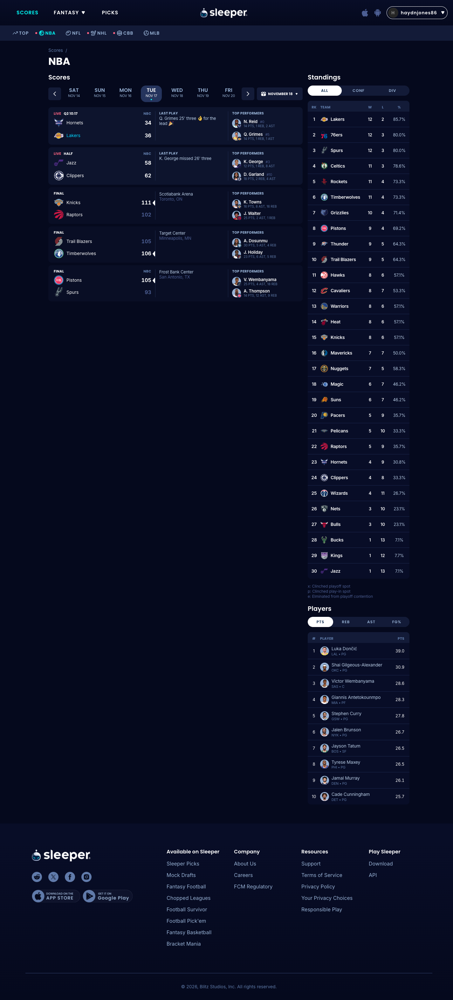

- **Purpose.** The NBA hub for a given day: scores, ladder and leaders.
- **Primary goal.** See what is on today and who is performing.
- **Layout.** Fixed left sport bar (top-level `SCORES FANTASY PICKS`, centred wordmark, store glyphs, account chip), a sport tab strip (`TOP NBA NFL NHL CBB MLB`), then a two-column body: 60% scores column, 40% standings rail, with the players table below the standings.
- **Components.** Date carousel; five game cards; standings table with tabs and legend; players table with stat tabs; four social links and two store badges; full footer.
- **Data.** Live and final games with quarter clocks, broadcaster (`NBC`, `ESPN`), arena, top performers. Standings 1–30 with `W L %`. Players 1–10 by chosen stat.
- **States.** `LIVE` (with clock), `FINAL`, clinch markers. No empty state is reachable — the league always has games [?]. No loading skeleton observed.
- **Navigation.** Game cards → game page; player rows → player page; sport tabs → sibling sections; footer → marketing pages.
- **UX observations.** The scores column ends around 40% of the page height while standings and players run to 1,600px, leaving a large empty band on the left [O]. Two different "tab" treatments sit side by side (standings pills, player pills) with the same look but different content models. Live cards carry a lot of text at small sizes (11–12px) [O].
- **Responsive.** Mobile stacks everything into one column, keeps the date carousel, drops the broadcaster/venue column to a single line, and compresses the footer to one row of links. Standings and players become full-width tables; no horizontal scroll needed.
- **Evidence.** Layout, labels, values [O]. Whether scores paginate [I].

### 02 — Game page

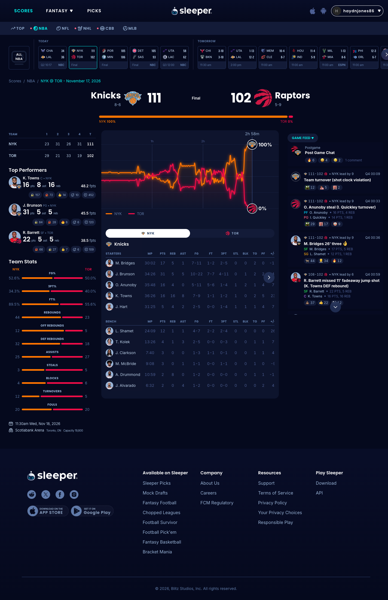

- **Purpose.** Everything about one fixture.
- **Primary goal.** Understand the result and how it happened.
- **Layout.** Scoreboard band, win-probability bar, then a three-column body: quarter/line score + top performers + team stats (left), win-probability chart and box score (centre), Game Feed (right). A horizontal game carousel sits above the scoreboard.
- **Components.** Team crests with records; `Final` badge; per-team probability bar; quarter table; three performer cards with stacked stat lines and per-stat reaction chips; nine comparison bars (FG%, 3PT%, FT%, rebounds, off/def rebounds, assists, steals, blocks, turnovers, fouls); line chart with team toggle; box score split starters/bench; feed entries with player thumbnails, play text, and reaction counts.
- **Data.** Quarter scores, per-player `MP PTS REB AST FG FT 3PT STL BLK TO PF +/-`, win probability as a percentage and a time series, venue and capacity.
- **States.** Final is observed; live equivalents exist on the landing [I]. Chart appears to render a partial series with a hard step [O].
- **UX observations.** The win-probability chart's two series end at 100%/0% with large marker bubbles that overlap the axis labels [O]. The left column runs long while the centre column ends early, so the page has three different bottom edges [O]. Reaction chips on both performers and feed entries share a visual weight with real controls [O].
- **Responsive.** Mobile collapses to scoreboard + probability + chart, then a `box / feed / stats` segmented control — the desktop's three columns become three tabs, and the box score shows only `MP PTS REB AST FG` with the rest behind horizontal scroll [O]. This is a genuine information loss, not just reflow.
- **Evidence.** All values [O]. Chart semantics [?].

### 03 — Player page

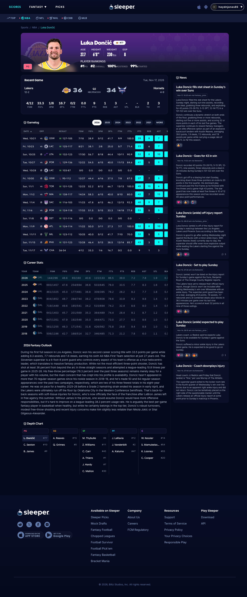

- **Purpose.** Research one player for a fantasy decision.
- **Layout.** Purple hero card (photo, name, team, `AGE / HEIGHT / WEIGHT / EXP`, ranking strip), then two columns: main (recent game, gamelog, career stats, outlook essay, depth chart) and news rail.
- **Components.** Ranking chips; recent-game box; gamelog table with colour-graded cells; career-season table; long-form prose; depth chart grouped by position with rank badges; news cards with timestamps, source (`via FantasyPros`), body text and reaction counts.
- **Data.** `FGM/FGA FG% 3PM/3PA 3P% FTM/FTA FT% PTS REB AST STL BLK TO PF` per game and per season, back to 2018.
- **States.** Played games and `0/0` unplayed rows both render, which reads as a real zero rather than "did not play" [O].
- **UX observations.** Heat-mapped cells use saturated cyan/magenta at full-bleed, which competes with the scoreboard for attention [O]. Depth chart shows five columns of names with rank numbers but no explanatory legend [O]. The outlook is a wall of prose at 13px inside a data page [O].
- **Responsive.** Mobile replaces the stacked sections with `GAMELOG / NEWS / DEPTH CHART` tabs; the hero compresses and the name wraps; tables scroll horizontally and clip columns [O].
- **Evidence.** Values [O]. Whether "did not play" is treated differently in scoring [I].

### 04 — Create league, step 1

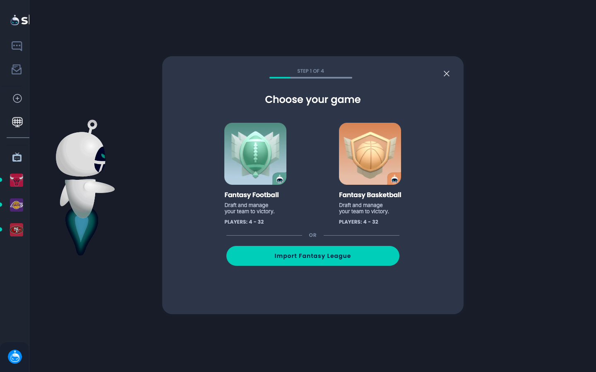

- **Purpose.** Start a league.
- **Layout.** Centred modal on a dimmed app shell; left rail with icons and three team shortcuts; mascot illustration behind the modal.
- **Components.** `STEP 1 OF 4` label and 4-segment bar, `Choose your game` heading, two illustrated cards (Football green, Basketball orange) each with a one-line description and `PLAYERS: 4 - 32`, an `OR` divider, and `Import Fantasy League`.
- **States.** One card is selectable; the state after selection is shown on step 2 [I]. A close `×` sits top-right.
- **UX observations.** The mascot overlaps the modal's left edge, which looks like a z-index accident rather than art direction [O]. `PLAYERS: 4 - 32` for a basketball league is a football-derived constant [?]. No back button on step 1, only `×`.
- **Responsive.** Broken. At 390px the 145px icon rail stays fixed, the modal keeps its desktop width and overflows the viewport, card copy is clipped mid-word ("y Football", "Fantasy Bas"), the mascot sits on top of the cards, and `Import Fantasy League` runs off-screen [O].
- **Evidence.** Copy and layout [O]. Wizard state persistence [?].

### 05 — League, Draft (pre-draft)

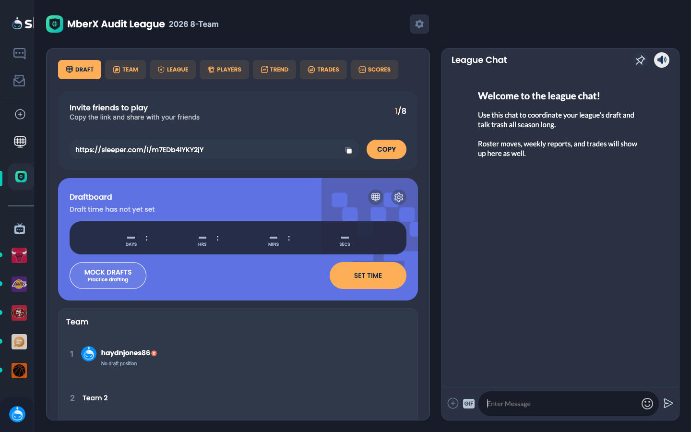

- **Purpose.** The league's home before a draft time exists.
- **Layout.** Left icon rail; league header (crest, name, season/format, settings gear); main column with tab row and three stacked cards; right rail league chat.
- **Components.** `DRAFT TEAM LEAGUE PLAYERS TREND TRADES SCORES` tab row with icons, active tab in orange; invite card with member counter `1/8` and copyable URL; blue draftboard card with countdown placeholders and two CTAs (`MOCK DRAFTS / Practice drafting`, `SET TIME`); team list with crown; chat composer.
- **Data.** Invite token, member count, team slots (8), draft time unset.
- **States.** Pre-draft only. No draft time → countdown renders em dashes rather than hiding [O].
- **UX observations.** Two competing primaries in the draftboard card (outlined `MOCK DRAFTS` and filled orange `SET TIME`) [O]. The tab row mixes filled-orange active state with icon+label pairs that read as buttons, not navigation [O]. Chat is always-on and occupies a third of the width even when the league has one member [O].
- **Responsive.** Broken. Fixed 145px rail, content wider than the viewport, tab row clipped after `PLAYERS`, invite URL cut mid-token, countdown cut, chat rail dropped entirely with no replacement [O].
- **Evidence.** Copy, counts, routes [O]. `LEAGUE` and `TRADES` content [?].

### 06 — League, Players

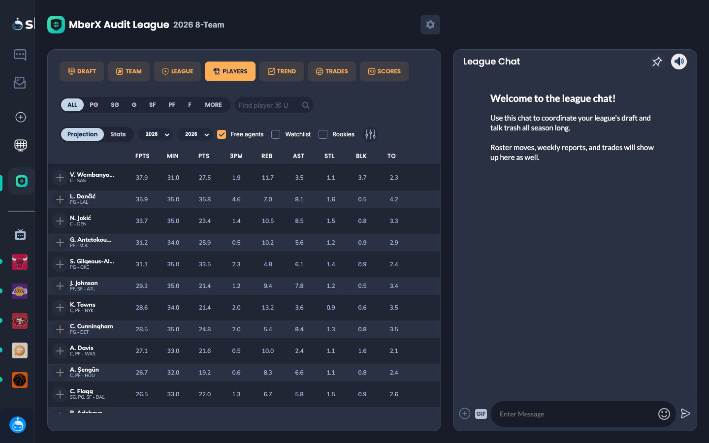

- **Purpose.** Browse and add players.
- **Components.** Position chips with counts (`ALL`, then `PG/SG/G/SF/PF/F`), search field with `⌘U` hint, `Projection | Stats` segmented toggle, two season selects, three filter checkboxes, sort control, and a table with per-row `+`.
- **Data.** `FPTS MIN PTS 3PM REB AST STL BLK TO`, projections as decimals.
- **UX observations.** Two adjacent season dropdowns both show `2026`, with no visible distinction between them [O]. Player names truncate with ellipsis at ~18 characters even when the row has free space [O]. The `+` add has no confirmation or feedback in view [O/I].
- **Responsive.** Broken — rail fixed, chips cut at `PF`, table cut after `MIN`, filters off-screen [O].
- **Evidence.** Columns and values [O]. What the second dropdown filters [?].

### 07 — League, Team (stubbed)

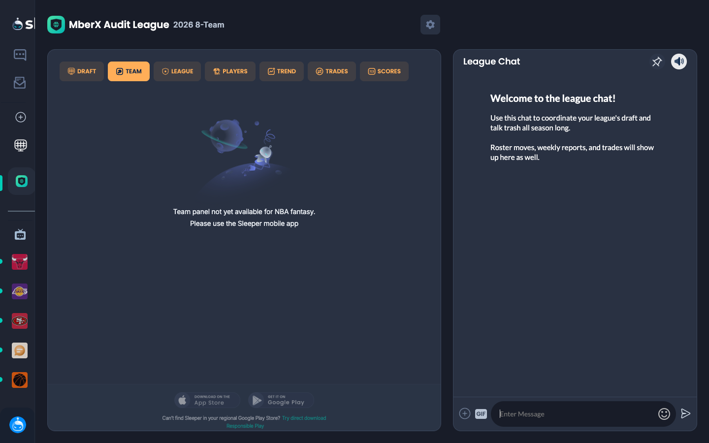

- **Purpose.** Roster management. Not implemented on web for NBA.
- **Content.** Mascot illustration, `Team panel not yet available for NBA fantasy. Please use the Sleeper mobile app`, App Store and Google Play badges, `Can't find Sleeper in your regional Google Play Store? Try direct download`, `Responsible Play`.
- **UX observations.** The tab is present and clickable but leads to a dead end; the only escape is the tab row. The message correctly sets expectation rather than failing silently — the better version of this pattern [O].
- **Responsive.** Same message, same overflow problems as other league tabs [O].
- **Evidence.** All copy [O]. Whether the mobile app truly has this panel [I].

### 08 — Mock drafts

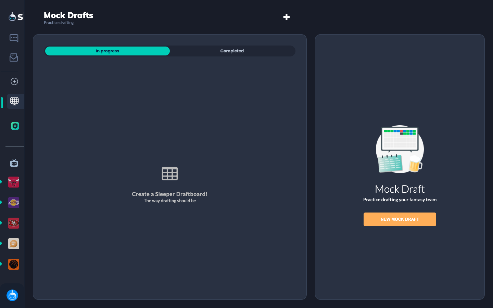

- **Purpose.** Practice drafting without a league.
- **Layout.** Two-card layout: a large left card with segmented `In progress / Completed` and an empty state, and a right card with an illustration and `NEW MOCK DRAFT`.
- **UX observations.** The empty state ("Create a Sleeper Draftboard! The way drafting should be") sits far below the segmented control with no CTA of its own, so the actionable path is the separate right card [O]. The `+` in the header duplicates `NEW MOCK DRAFT` [O].
- **Responsive.** Broken: the two cards stack but keep desktop widths, so the right card is entirely off-screen and the empty state text is clipped [O].
- **Evidence.** Copy and structure [O]. Completed-draft list content [?].

### 09 — Draft room, lobby

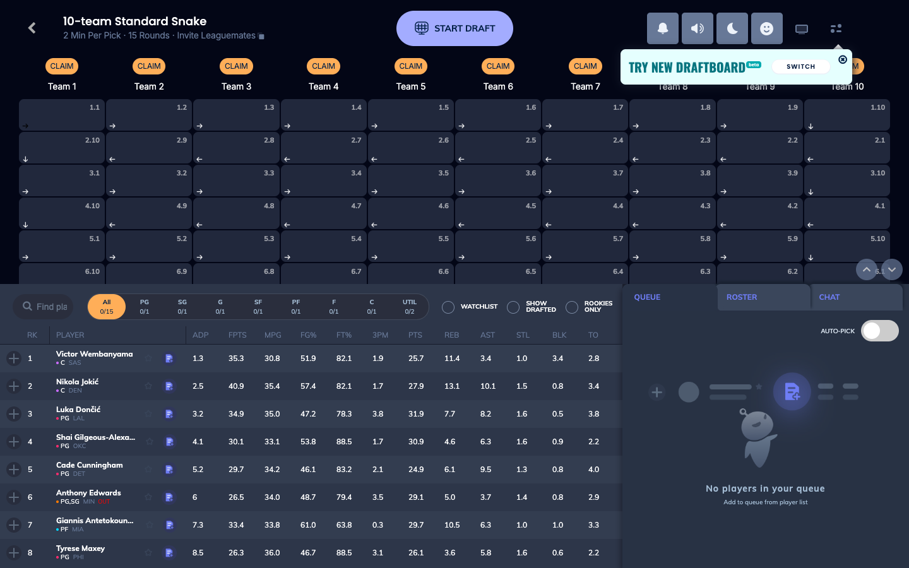

- **Purpose.** Assemble teams and start a snake draft.
- **Layout.** Full-bleed dark room: header (back, title, format line, `START DRAFT`, five utility icons), `TRY NEW DRAFTBOARD beta SWITCH` banner, team row with `CLAIM` buttons, 15×10 pick grid, then a bottom split: player pool (left) and `QUEUE / ROSTER / CHAT` panel (right).
- **Components.** Pick cells numbered `round.pick` with direction arrows; `AUTO-PICK` toggle; queue empty state; position chips with per-position counts (`All 0/15`).
- **Data.** `10-team Standard Snake`, `2 Min Per Pick`, `15 Rounds`, ADP and projection columns.
- **States.** Unclaimed teams show `CLAIM`; unclaimed picks are blank with direction arrows.
- **UX observations.** Extremely dense: 150 pick cells, a 9-column table and a chatbot in one view at 13px [O]. The beta banner overlays the right-hand team headers [O]. `CLAIM` is repeated twice per team (button plus label) [O].
- **Responsive.** Mobile shows 3 board columns with horizontal scroll, header text wraps into a narrow column ("2 Min Per Pick" over four lines) and `START DRAFT` is clipped off-screen; the queue/roster/chat panel is not visible [O].
- **Evidence.** Structure and labels [O]. Whether `START DRAFT` requires all teams claimed [I].

### 10 — Draft room, live

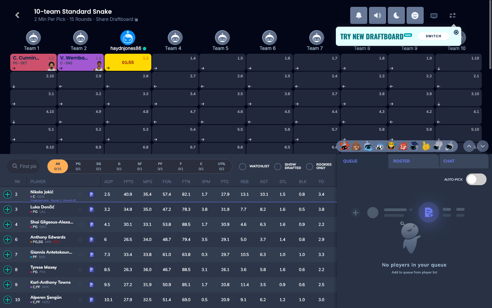

- **Purpose.** Make picks against a clock.
- **States.** Completed picks show player, position-team and a headshot on a tinted cell; the active pick is yellow with a countdown (`01:55`); drafted players leave the pool; the pool annotates `Prospect pick · Round 1, Overall #1`; a floating emoji bar appears over the board [O].
- **UX observations.** The pick you are on is clear, which is the single most important job of this screen [O]. Team colours used for completed picks (red, purple) carry no legend and may collide with team identity [O]. Emoji reactions spawn over the pick grid and obscure cells [O].
- **Responsive.** Same overflow as the lobby; the active pick stays visible, the player pool is usable, the queue panel is not [O].
- **Evidence.** Live state, timer, annotations [O]. Pick confirmation and undo [?].

### 11 — League, Trend

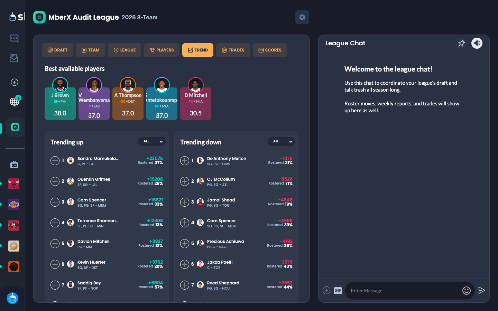

- **Purpose.** Show who is hot, cold and available.
- **Components.** `Best available players` as five overlapping photo cards with name, position, team and projection; `Trending up` and `Trending down` ranked lists with signed deltas and `Rostered %`; per-list `ALL` filter; per-row `+`.
- **UX observations.** The five cards overlap so that names and positions are clipped by the next card ("A Thompson", "G•DET" cut) [O]. Deltas are raw integers with thousands separators and no unit, so the scale is unclear [O]. Trending up and down are visually identical apart from number colour — colour-only meaning [O].
- **Responsive.** Broken in the same way as other league tabs; cards shrink and clip further [O].
- **Evidence.** Values [O]. What the delta measures [?].

### 12 — League, Scores (stubbed)

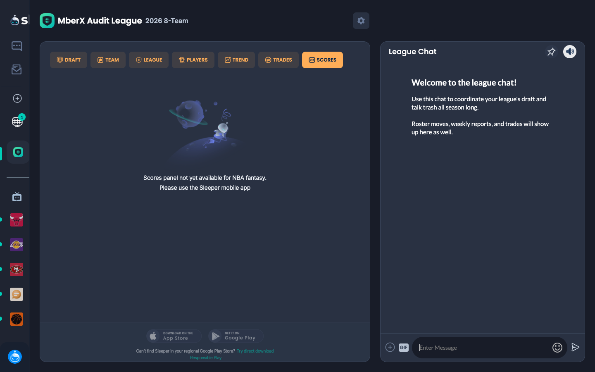

- **Purpose.** Weekly head-to-head scores. Not implemented on web for NBA.
- **Content.** Identical stub to the Team panel: `Scores panel not yet available for NBA fantasy. Please use the Sleeper mobile app`, store badges, direct-download link, `Responsible Play`.
- **UX observations.** Together with screen 07 this means the two screens a fantasy player checks most often — their roster and their matchup — do not exist on web [O].
- **Responsive.** Same overflow pattern [O].

## 5. User roles & permissions

| Role | Evidence | Can do | Gaps |
|---|---|---|---|
| **Visitor** | Public pages render fully signed-out [O] | Browse scores, standings, game and player pages; start the create-league wizard | Whether a visitor can complete league creation without an account [?] |
| **Signed-in player** | Account chip `haydnjones86`, league creation succeeded [O] | Create a league, claim a team, draft, browse players, view trend, use league chat | Roster moves, trades, waivers not reachable on web [O] |
| **Commissioner** | Crown badge on the account's team row; gear in the league header [O] | Presumably settings, draft time, invites | The gear's surface was not opened [?] |
| **Leaguemate** | Seven empty team slots [O] | Presumably claim a team, chat, draft | Join flow from an invite link not exercised [?] |

Admin/commissioner capability is inferred from affordances only; no permission-denied states were seen [O for badges, ? for behaviour].

## 6. Key user flows

### F1 — Browse NBA without an account
`/nba` → game card → game page → box score/feed → player link → player page. Success is simply content; no account prompt appeared during this run [O].

### F2 — Create a league
`/leagues` → redirect to `/leagues/create` → step 1 game → step 2 name + team count → step 3 scratch vs copy → step 4 league type + draft type → `CREATE LEAGUE` → `/leagues/<id>/predraft`. All four steps completed successfully [O]. Success signal is the new league header plus a `1/8` invite counter [O]. Branch: `Import Fantasy League` was not exercised [?].

### F3 — Invite
Predraft → copy `https://sleeper.com/i/<token>` → share manually. No in-product email/SMS invitation observed, and no sent-status list [O for the link, ? for delivery].

### F4 — Practice draft
Predraft → `MOCK DRAFTS` → `/draftboards/<leagueId>` → `NEW MOCK DRAFT` (or `NEW MOCK NBA DRAFT` on `/draftboards`) → draft room lobby → `START DRAFT` → live draft [O].

### F5 — Draft a team
Lobby → `CLAIM` a team → `START DRAFT` → picks auto-advance on the clock; the active pick highlights with a countdown; the player pool updates after each pick [O]. Branch: `AUTO-PICK` toggle exists [O]; its exact behaviour was not exercised [?].

### F6 — Manage a roster
`TEAM` tab → stub. Dead end on web for NBA, with a mobile-app handoff [O].

## 7. Domain entities & data model

**Whole section inferred [I]** — derived from visible fields and routes.

```
Sport        code (nba), display name, season
Team         id, city/name, abbreviation (NYK), logo, record {w,l}
Player       id, slug, name, teamId, positions[], age, height, weight, exp,
             rankings {position, overall, rostered%, started%}, headshot
Game         id, sport, date, awayTeamId, homeTeamId, status {scheduled|live|final},
             period, clock, scores[], venue, capacity, broadcaster,
             lastPlay, topPerformers[], winProbability[], lineScore[4]
PlayerGame   playerId, gameId, minutes, pts, reb, ast, stl, blk, to, pf,
             fgm/fga, 3pm/3pa, ftm/fta   ← gamelog and box-score rows
Projection   playerId, season, fpts, min, pts, 3pm, reb, ast, stl, blk, to
Trend        playerId, direction {up|down}, delta, rosteredPct, window
League       id, name, sport, season, teamCount, avatar, visibility,
             commissionerUserId, inviteToken, draftTime, settings{roster, playoffs,
             waivers, tradeDeadline, irSlots, scoring{}}
Membership   leagueId, userId, teamSlot, teamName, avatar, isCommissioner,
             draftPosition, claimed
Draft        id, leagueId, type {snake|linear|auction}, rounds, pickSeconds,
             status {lobby|live|complete}
Pick         draftId, round, pick, overall, teamSlot, playerId, madeAt
ChatMessage  leagueId (or draftId), authorId, body, attachments[], reactions[]
Reaction     targetType {game|play|article|message}, targetId, emoji, userId?
```

Relationships: a `League` has many `Membership`s and one `Draft`; a `Draft` has `rounds × teams` `Pick`s; `Player` joins `Pick`, `Membership` and `PlayerGame`. Routes address a league by numeric id and a draft by its own id, and games by a `away-home-date` slug [O].

Enumerations observed: game status `LIVE | FINAL` [O]; draft type `Snake | Linear | Auction` [O]; league type `Redraft | Keeper | Dynasty` [O]; positions `PG SG G SF PF F C UTIL` [O].

## 8. Integrations & third-party services

- **OneTrust consent** [O] — `OptanonConsent` cookie and a preferences dialog with `Allow All` / `Confirm My Choices`.
- **hCaptcha** [O] — invisible and challenge iframes on `newassets.hcaptcha.com` during league creation.
- **Intercom** [O] — support iframe present on league screens.
- **Statsig** [O] — `statsig.stable_id` cookie, i.e. feature flags and experiments; likely behind the `TRY NEW DRAFTBOARD beta` banner [I].
- **App Store / Google Play** [O] — badges and a `Try direct download` fallback on every stub screen.
- **Sports data provider** [?] — scores, projections, injuries and news (`via FantasyPros` on news cards [O]) imply a licensed feed; the provider is not named in the UI.
- **GIF and emoji providers** [I] — `GIF` button in chat and an emoji picker in the draft room; vendors unknown.
- **Google / Apple sign-in** [I] — store glyphs in the top bar look like auth entry points; not exercised.

## 9. Cross-cutting patterns

- **Navigation** [O]: a global icon rail, a sport tab strip, and a league tab row — three nav layers on every league screen. Tabs are real routes (`/players`, `/trend`, `/scores`), so they are deep-linkable.
- **Search** [O]: a single `Find player ⌘U` field with a keyboard shortcut, available in the league player pool and draft room. No global search.
- **Filters** [O]: position chips with counts, season selects, three boolean checkboxes, and per-list `ALL` filters. Filters reset on navigation [?].
- **Sorting** [O]: a dedicated sort icon; column headers are not clickable in the league tables.
- **Pagination** [?]: the player pool scrolls with `Show more`-like behaviour not observed; standings render all 30 rows.
- **Empty states** [O]: consistently illustrated with a mascot and a one-line explanation — the best-executed pattern in the product.
- **Feature stubs** [O]: two league tabs answer with `…not yet available for NBA fantasy. Please use the Sleeper mobile app`.
- **Notifications** [O]: bell, sound and mute controls in the draft room only.
- **Dates and units** [O]: US format (`November 17, 2026`, `Sat Nov 14`), 12-hour clocks, US venues and broadcasters; no timezone selector.
- **i18n** [O]: none visible; English only.
- **Social proof** [O]: emoji reactions with counts on games, plays, articles and chat; avatars everywhere.

## 10. Responsive & feature-parity notes

Desktop 1440 and mobile 390 differ by screen type:

- **Public NBA screens adapt properly** [O]: nav collapses to a hamburger, sport tabs scroll horizontally, scores and tables stack, and the footer compresses. Nothing is lost.
- **Game page trades content for tabs** [O]: `box / feed / stats` replaces the three-column layout, and the box score drops `FT 3PT STL BLK TO PF +/-` behind horizontal scroll. Top performers and team stats are only reachable through the `stats` tab.
- **Player page trades sections for tabs** [O]: `GAMELOG / NEWS / DEPTH CHART`; gamelog and career columns clip.
- **League screens do not adapt at all** [O]: the 145px icon rail is fixed, cards keep desktop widths, content overflows the viewport, tab rows clip mid-label, and the league chat rail disappears with no mobile equivalent. This affects screens 04–12.
- **Feature parity** [O]: `Team` and `Scores` panels are desktop-absent by design and point to the mobile app; the draft room's queue/roster/chat panel is desktop-only in practice because it is off-screen on mobile.
- **Emulation caveat** [O]: mobile viewports were produced by Chromium viewport emulation, not a real device or the native app. The native app was not audited.

## 11. UX quality assessment

Observations only — not a WCAG audit.

**Status visibility.** Strong. `LIVE Q2 10:17`, `FINAL`, clinch markers, countdown timers and the highlighted active pick all answer "what is happening" without a legend [O]. The one gap is the league player pool, where an add gives no visible confirmation [O/I].

**Recognition over recall.** Position chips carry counts and abbreviations, team crests repeat everywhere, and stat tabs are labelled [O]. Weak on the trend deltas (raw integers, no unit) and the depth chart (rank numbers without explanation) [O].

**Consistency.** Two tab idioms coexist (pill tabs in tables, icon tabs in the league shell) [O]. Button hierarchy is unstable: the predraft card offers an outlined and a filled primary side by side [O]. The `+` and `NEW MOCK DRAFT` duplicate one action [O].

**Error prevention.** The draft's `START DRAFT` and pick actions offer no visible confirmation or undo [I]. The create wizard has no `Back` on step 1, only `×`, so abandoning loses work silently [I].

**Feedback.** Reactions, timers and live scores give immediate feedback [O]. Adds, claims, copies and chat sends gave no visible confirmation in the captured states [O].

**Accessibility observations** [O unless marked]:
- Body text frequently sits at 11–13px, including table headers and stat lines.
- Colour carries meaning in several places: trend deltas (red/green only), heat-mapped gamelog cells, team-tinted draft picks.
- Custom controls (chips, segmented toggles, icon tabs) expose labels but their roles were not verified; the a11y snapshot of league screens returned almost no controls [O].
- Horizontal overflow on mobile traps content off-screen with no affordance that it exists.
- Native `<table>` semantics exist on public screens [O]; league tables are div grids [I].
- Focus states were not observed in any captured state [?].

**Friction list, ranked.**
1. Two of seven league tabs are dead ends on web, including roster and matchup [O].
2. The league shell is not responsive; every league screen overflows at 390px [O].
3. The create-league modal is unusable at mobile width [O].
4. Information loss on mobile game and player pages (columns dropped into scroll) [O].
5. Dense draft room: 150 pick cells, a 9-column table and chat in one 13px view [O].

## 12. Reverse-engineering scope

### Must build [O]
- Public NBA landing: daily date carousel, game cards with status/last play/top performers, 30-row standings with `ALL/CONF/DIV` and clinch legend, stat-tabbed player leaderboard.
- Game page: scoreboard with records, win-probability bar and chart, quarter line score, top performers, team-stat comparison bars, starters/bench box score, play-by-play feed with reactions.
- Player page: ranking strip, recent game, heat-mapped gamelog, career stats, long-form outlook, depth chart, news rail with reactions.
- Four-step league creation wizard with progress, team count (4–32), scratch-vs-copy, league type and draft type.
- League shell with seven routed tabs and a persistent chat rail on wide viewports.
- Invite link with copy and member counter.
- Player pool with position chips, search shortcut, projection/stats toggle, season selects, three filters, and per-row add.
- Trend tab with best-available cards and trending up/down lists with deltas.
- Mock draft hub with in-progress/completed segmentation.
- Draft room: claimable teams, snake pick grid with direction arrows, start draft, per-pick countdown, drafted-player removal, queue/roster/chat panel, auto-pick.
- Emoji reactions on games, plays, articles and chat.
- Illustrated empty states and explicit "not available on web" stubs.

### Strongly implied [I]
- Commissioner settings behind the gear icon.
- League visibility and join-by-link acceptance flow.
- Projection and stat pipelines per season and per game.
- Chat scoped to league and draft, with attachments and GIFs.
- Feature-flag delivery for the draftboard beta.

### Uncertain [?]
- What `LEAGUE` and `TRADES` contain; whether `TRADES` is also stubbed for NBA.
- Whether `START DRAFT` requires all teams claimed.
- Whether picks can be undone, or edited after submission.
- What `AUTO-PICK` does at the pick and round level.
- Whether the second season dropdown on the player pool changes the projection season or the stat season.
- What the trend delta measures and over what window.
- Whether league creation works end-to-end for a signed-out visitor.

### Not evidenced
Roster/lineup editing, matchup scoring, waivers, trades, playoffs, league standings, commissioner tools, notifications for league events, mobile-native equivalents.

### Complexity flags
- **Realtime** — live scores, draft countdowns and shared draft state.
- **Sports data** — games, box scores, projections, injuries, news; several feeds that must agree.
- **RBAC** — visitor, member, commissioner, plus per-league permissions.
- **Multi-tenancy** — every league entity scoped by league id; drafts by draft id.
- **Draft state machine** — lobby → live → complete, with snake order, timers and auto-pick.
- **Uploads** — league avatar upload during creation.
- **Bot protection and consent** — hCaptcha and OneTrust in the critical path of league creation.
- **Experimentation** — Statsig flags around the draftboard beta.
- **i18n** — none; US locale and US sports assumptions are hard-coded.

### Open questions for a human
1. Is the web stub for `Team` and `Scores` a permanent product decision or a gap in progress? It determines whether a rebuild needs roster and matchup screens at all.
2. Which sports-data provider supplies projections and injuries, and how fresh must they be?
3. What does the trend delta represent, and what window is `Rostered %` measured over?
4. Are league tables virtualised? The player pool implies hundreds of rows.
5. What is the mobile app's roster and matchup design, since web deliberately defers to it?

## 13. Capture log

All times 18 Nov 2026, Australia/Sydney. Browser: Chrome (user's paired profile, signed in as `haydnjones86`). Desktop 1440×900 at 1× DPR; mobile 390×844 emulated at 2× DPR with touch. Read-only except where noted.

| Time | Screen | Route | Viewport | File | Source | Notes |
|---|---|---|---|---|---|---|
| 15:54 | NBA landing | `/nba` | desktop | `01-nba-landing-desktop.png` | captured | — |
| 15:55 | NBA landing | `/nba` | mobile | `01-nba-landing-mobile.png` | captured | — |
| 15:56 | Game page | `/nba/scores/nyk-knicks-tor-raptors-2026-11-17` | desktop | `02-game-final-desktop.png` | captured | FINAL game |
| 15:56 | Game page | same | mobile | `02-game-final-mobile.png` | captured | — |
| 15:56 | Player page | `/nba/players/luka-doncic-1970` | desktop | `03-player-desktop.png` | captured | — |
| 15:56 | Player page | same | mobile | `03-player-mobile.png` | captured | — |
| 15:57 | Create league step 1 | `/leagues/create` | desktop | `04-create-league-desktop.png` | captured | consent dialog dismissed first |
| 15:57 | Create league step 1 | same | mobile | `04-create-league-mobile.png` | captured | — |
| 15:58 | League predraft | `/leagues/1428643783574048768/predraft` | desktop | `05-league-predraft-desktop.png` | captured | league created by the agent (see interactions) |
| 15:58 | League predraft | same | mobile | `05-league-predraft-mobile.png` | captured | — |
| 15:58 | League players | `/leagues/<id>/players` | desktop | `06-league-players-desktop.png` | captured | — |
| 15:58 | League players | same | mobile | `06-league-players-mobile.png` | captured | — |
| 15:59 | League team | `/leagues/<id>/team` | desktop | `07-league-team-desktop.png` | captured | stub screen |
| 15:59 | League team | same | mobile | `07-league-team-mobile.png` | captured | — |
| 15:59 | Mock drafts | `/draftboards/<leagueId>` | desktop | `08-mock-drafts-desktop.png` | captured | — |
| 15:59 | Mock drafts | same | mobile | `08-mock-drafts-mobile.png` | captured | — |
| 16:00 | Draft lobby | `/draft/nba/<draftId>` | desktop | `09-draft-lobby-desktop.png` | captured | before `START DRAFT` |
| 16:00 | Draft lobby | same | mobile | `09-draft-lobby-mobile.png` | captured | — |
| 16:00 | Draft live | same | desktop | `10-draft-live-desktop.png` | captured | after `START DRAFT`, pick 1.3 on the clock |
| 16:00 | Draft live | same | mobile | `10-draft-live-mobile.png` | captured | — |
| 16:00 | League trend | `/leagues/<id>/trend` | desktop | `11-league-trend-desktop.png` | captured | — |
| 16:00 | League trend | same | mobile | `11-league-trend-mobile.png` | captured | — |
| 16:00 | League scores | `/leagues/<id>/scores` | desktop | `12-league-scores-desktop.png` | captured | stub screen |
| 16:00 | League scores | same | mobile | `12-league-scores-mobile.png` | captured | — |

**Interactions performed (with user consent):**
- Dismissed the OneTrust consent dialog via `Confirm My Choices`.
- Created league **MberX Audit League** (Fantasy Basketball, 8 teams, Redraft, Snake) to make the league core loop reachable; the account had no leagues.
- Started a mock draft and pressed `START DRAFT`; two bot picks were made and the clock was running at capture time. No pick was submitted by the agent.
- Opened the `TREND` and `SCORES` league tabs.

**Failures and gaps:**
- `Team` and `Scores` league panels are stubbed on web by the product, not by capture failure.
- `LEAGUE` and `TRADES` tabs did not respond to text-selector clicks; their content is `[?]`.
- `/leagues/<id>/draft`, `/draftboard`, `/draftboards/new` and `/settings` returned blank documents.
- `/leagues` redirects to `/leagues/create` for an account with no leagues, so the league list screen is not evidenced.
- `Export`, if any, and commissioner settings were not opened.

**Capture caveats:**
- League and draft screens use internal scroll containers, so `fullPage` produced viewport-height images (900px desktop, 1688px mobile). Those shots show the first screen only.
- Mobile viewports were Chromium emulation with touch, not a device or the native app.
- Signed-out states were not captured; the session was authenticated throughout.
